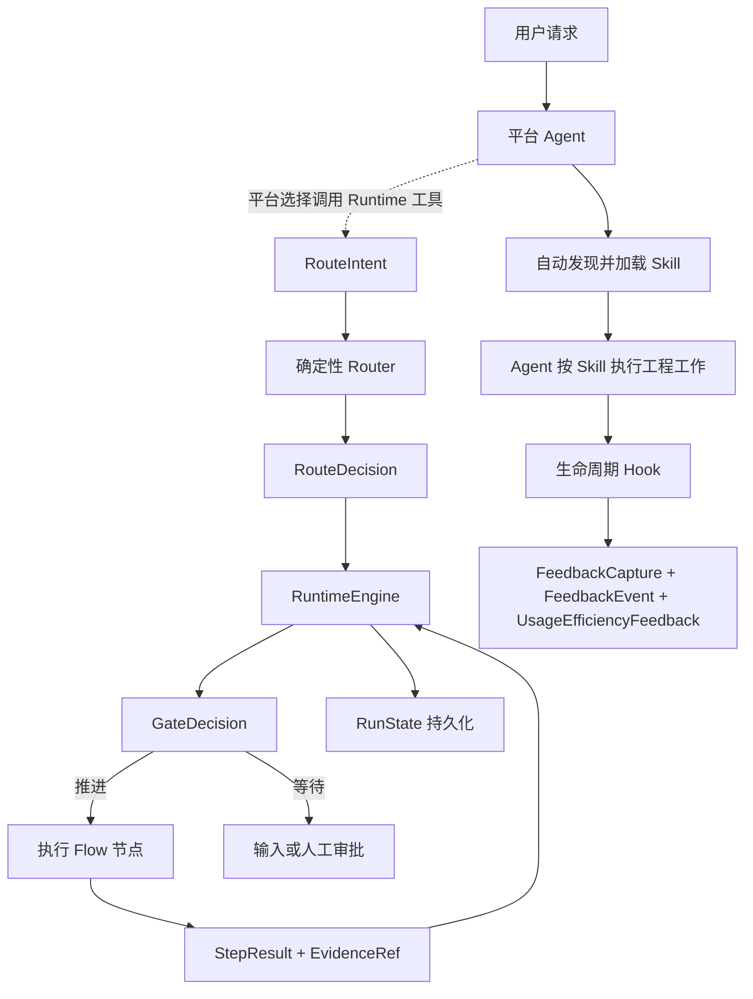

## GPT-6 适配变更说明

团队版运行、反馈和观测使用独立目录；旧共享目录不自动迁移或合并。

# teamwork-engineering-assistant

`agent-skills` 是 `teamwork-engineering-assistant`（团队研发助手）的统一作者源。产品完整继承 `engineering-assistant` 的 11 个工程原语、运行内核和平台协议，并以默认 `rrq-yq-team` profile 扩展团队交付流程与规范。

- 当前版本：`3.0.0.0-rc.1`
- 开发者：`sunliming625@gmail.com`
- 运行平台：Codex、Hermes
- 开发语言：Python 3.9+
- 默认语言：简体中文，同时保留中英文任务路由能力
- 产品默认 profile：`rrq-yq-team`；可显式切换通用 `default`

## 项目定位

本项目不把研发流程拆成大量需要用户记忆的阶段命令，而是将能力划分为四层：

1. 公开 skill：面向用户和模型的稳定工程原语。
2. 内部 flow：组织多步骤任务的有向无环图。
3. capability/policy pack：只在相关领域进入范围时加载的专业能力和规则。
4. runtime kernel：负责路由、状态、证据、门禁、恢复和平台构建；CLI、核心工具 ID 和 artifact 路径保持 `ea`、`engineering_assistant_*` 和 `.run-artifacts/teamwork-engineering-assistant/` 兼容；Hermes 注册名带团队前缀。

目标是让执行过程可预测，而不是把输出固定成模板。Agent 负责语义判断和工程工作，运行时负责确定性状态与安全边界。

## 快速开始

### 普通用户

已经安装插件时，不需要执行 `pip install` 或手动维护 `ea` 状态机，直接在 Codex App 或 Hermes 中用自然语言描述任务即可。例如：

```text
请先梳理当前仓库上下文，再给出最小充分的实现方案。
基于代码证据诊断这个问题，说明根因、影响和验证结果。
评审当前变更是否同时符合仓库规范和原始需求。
```

Codex 可以根据 skill 的名称和描述自动选择能力，也可以通过 `$repo-context`、`$diagnosing-bugs`、`$code-review` 等名称显式调用。当前 Hermes 插件 skill 通过产品限定名显式加载，不进入普通 available_skills 索引：

```bash
hermes --skills teamwork-engineering-assistant:repo-context
```

### 从仓库安装到本机

先执行无副作用预演，再显式确认本机发布：

```bash
python3 scripts/publish_local.py --platform codex --dry-run
python3 scripts/publish_local.py --platform codex --yes

python3 scripts/publish_local.py --platform hermes --dry-run
python3 scripts/publish_local.py --platform hermes --yes
```

同时安装两个平台时，将 `--platform` 改为 `all`。发布脚本会完成测试、评测、构建、摘要校验、备份、原子替换、平台注册和安装后验证。详细行为见 [本机发布](docs/operations/local-publish.md)；真实产品收益验证见 [真实产品 Canary](docs/operations/canary.md)。

### 当前平台集成边界

当前发布包会自动注册 11 个公开 skill，并将同一 Runtime 控制面接入平台：Codex 通过包内 `.mcp.json` 启动 stdio MCP，Hermes 通过插件工具注册复用相同 `RuntimeTools`。两个 adapter 也会注册共享的反馈采集器：Codex 只为本插件 namespaced MCP 工具注册 `PreToolUse` 与 `PostToolUse`，Hermes 在插件 adapter 内使用 `post_llm_call`。

| 能力 | 当前行为 |
| --- | --- |
| 发现并选择公开 skill | 平台可根据任务隐式选择，也支持用户显式指定 |
| 加载 `SKILL.md` 和按需参考资料 | 选择 skill 后由平台完成 |
| `route/start/next/complete` | 平台可作为工具调用；`start` 接收 intent 并在服务端重算路由，选择 skill 本身不会隐式启动状态机 |
| `design-source-intake/recheck` | intake 读取外部源并向目标项目写入副本、注册表及摘要；recheck 只读核对该 intake 的全部冻结源是否变化 |
| `ea artifact-validate --kind database-design` | 只读校验关系型 OLTP 设计是否严格保留团队模板的章节顺序、层级和表头，且无未解析占位符 |
| `ea artifact-validate --kind review-package` | 只读校验需求独立评审包、`reviewing` 状态、基线元数据和追踪矩阵 |
| 人工审批与调研选择 | 本地记录用户明确决定并按 profile 的角色及范围检查；不提供身份验签 |
| `RunState` 持久化、DAG 推进和 Runtime 门禁 | 平台调用 Runtime 工具后生效，状态只写入目标项目 `.run-artifacts/teamwork-engineering-assistant/` |
| Hook 反馈采集 | Codex 仅从本插件 MCP Pre/Post 提升可观测的工具失败和 usage 信号；Hermes 可在插件轮次内补充纠正、阻断、返工和范围变化；两者都记录无原文 capture 元数据并支持独立审计处置 |
| `ea validate/artifact-validate/eval/build/verify-package/canary-audit/canary-prepare/canary-attestation-import/canary-assemble/canary-validate` | 由开发者、CI 或发布维护者执行 |

所以，当前产品体验是“平台选择 skill，必要时调用 Runtime 工具进入受治理运行，并由生命周期 Hook 采集反馈候选”。只有出现实际 Runtime 工具调用和落盘状态，才能声称状态机、证据门禁或恢复机制已运行。聊天中的“同意”不会自动转换为签名 grant。Codex 的插件 Hook 在用户审查并信任当前定义前会被跳过。

## 核心设计

- 单一事实源：skill、flow、policy、pack、provider、开源来源决策和 profile 的机器定义只存在于 `catalog/`。
- 渐进加载：公开 skill 只加载当前分支需要的 `references/` 和 pack，避免上下文膨胀。
- 可验证完成：flow 节点通过 `StepResult`、完成条件和 `EvidenceRef` 判断是否推进。
- 确定性门禁：高风险动作、审批、证据时效和状态转换由 runtime 执行。
- 可恢复运行：`RunState` 持久化当前节点、revision、审批和阻断原因，可在进程中断后继续。
- 平台无关核心：Codex 与 Hermes 共用相同 catalog、skills、packs、schemas 和 runtime，仅 adapter 不同。
- 无生成镜像：仓库不保存发布包或大面积派生副本，发布时从作者源临时构建。

## 仓库结构

```text
agent-skills/
├── catalog/                    # Product、Skill、Flow、Policy、Pack、规则目录、Provider、来源决策、Profile
├── skills/                     # 11 个公开 skill 及按需 references
├── packs/                      # 17 个专业能力与策略包
├── schemas/                    # 核心协议 JSON Schema
├── src/engineering_assistant/  # 路由、状态机、证据、编译器和平台 adapter
├── evals/                      # Routing、Behavior、State、Replay、Canary
├── tests/                      # 单元、行为、构建、发布和仓库治理测试
├── scripts/                    # 本机 Codex/Hermes 发布入口
├── config/                     # 当前本机发布策略
├── docs/architecture/          # 当前架构说明
├── docs/operations/            # 当前运维说明
├── VERSIONING.md               # 四段式版本规范
└── pyproject.toml              # Python 包与 ea CLI 配置
```

作者源职责：

| 变更内容 | 修改位置 |
| --- | --- |
| 产品身份和默认 profile | `catalog/product.json` |
| Skill 触发和完成语义 | `catalog/skills/` 与 `skills/` |
| Flow 节点和依赖 | `catalog/flows/` |
| 安全、审批和证据规则 | `catalog/policies/` |
| 专业领域能力 | `catalog/packs/` 与 `packs/` |
| 团队规则、来源和目标落点 | `catalog/rules/` |
| 能力提供方及供应链约束 | `catalog/providers/` |
| 开源能力采用决策与落点 | `catalog/sources/` |
| 公共数据协议 | `schemas/` 与 `model.py` |
| 路由和状态转换 | `router.py`、`engine.py`、`state_store.py` |
| 平台输出 | `adapters/codex.py`、`adapters/hermes.py` |
| 本机发布行为 | `local_publish.py`、`scripts/publish_local.py` |

## 公开 Skills

| Skill | 用途 |
| --- | --- |
| `engineering-assistant` | 将复杂工程请求路由到最小充分的 skill 或 flow |
| `research` | 基于一手资料研究外部项目、API、标准和技术事实 |
| `decision-interview` | 在事实调查后收敛范围、取舍和验收决策 |
| `domain-modeling` | 澄清领域术语、关系和难以逆转的决策 |
| `repo-context` | 从源码提取模块、接口、数据、依赖和影响范围 |
| `wayfinder` | 管理大型任务的目标、当前前沿和待决事项 |
| `prototype` | 用可丢弃的逻辑或界面原型回答一个设计问题 |
| `codebase-design` | 设计深模块、小接口、真实 seam 和局部化变更 |
| `tdd` | 以红绿循环和纵向切片实现已确认行为 |
| `diagnosing-bugs` | 通过复现、假设、定向观测和回归证据诊断问题 |
| `code-review` | 分别按仓库规范和原始需求评审固定 diff |

每个 skill 的 `SKILL.md` 只保留 `name`、`description` 和必要执行规则；专项资料放在同目录 `references/` 中按需加载。

## 内部 Flows

| Flow | 节点 |
| --- | --- |
| `shape` | 事实调查 → 决策收敛 → 需求契约 |
| `design` | 仓库上下文 → 条件化原型 → 架构 → 实现契约 → 设计评审 |
| `implement` | 选择切片 → 红绿循环 → 实现 → 质量证据 → 代码评审 |
| `review` | 固定比较点 → 代码评审/设计评审 → 结论门禁 |
| `release` | 发布就绪 → 发布验证 → 复盘 |
| `evolve` | 反馈摄取 → 知识提炼 → 候选变更 → 质量审计 |
| `team-delivery` | 需求事实 → 固定外部设计快照 → 决策/契约 → 完整 HLD/上下文设计评审稿与按需专项设计 → 评审包校验 → 目标摘要复核 → 可信设计审批 → 切片/TDD/实现 → 六维质量 → 发布验证 → 实现偏差与外部基线回写建议 |

Flow 不是提示词清单。`RuntimeEngine` 会消费 DAG、计算下一节点、检查审批和证据，并将状态持久化到目标项目。

## 能力与策略 Packs

| Pack | 激活条件 |
| --- | --- |
| `frontend-product` | 浏览器或应用用户体验发生变化 |
| `database` | Schema、查询、索引、事务或数据修复进入范围；关系型 OLTP 设计强制使用团队表级模板并通过格式校验 |
| `redis` | Redis key、缓存、锁或失效逻辑发生变化 |
| `mq` | Topic、消息体、生产消费、重试或回放发生变化 |
| `quality-evidence` | 实现、评审或发布需要声明完成 |
| `document-governance` | 创建、提升或废弃正式项目文档 |
| `release-safety` | 进入发布就绪、验证、回滚或生产观察 |
| `feedback-evolution` | 反馈可能改变 skill、flow、policy 或 eval |
| `team-standards` | 仓库或项目 profile 提供团队规则 |
| `rrq-yq-delivery` | 团队需求、文档、概要/详细设计和知识沉淀规则命中 |
| `rrq-yq-architecture` | 架构、DDD、JDK、框架和萤启约束命中 |
| `rrq-yq-api` | 接口、YApi 或异常契约命中 |
| `rrq-yq-code-quality` | 研发、TDD、质量、安全、日志、监控、幂等或并发命中 |
| `rrq-yq-frontend` | 影响范围命中前端 |
| `rrq-yq-database` | 影响范围命中数据库 |
| `rrq-yq-redis` | 影响范围命中 Redis |
| `rrq-yq-mq` | 影响范围命中 MQ |

团队规则目录固定包含 110 条规则、8 个来源记录和 8 个目标 packs。每条规则只有一个规范定义；`engineering_assistant_route` 会按内联 capability 或 flow 首节点返回团队 packs、规则和来源，后续 guidance 按当前节点渐进返回，内联任务也返回匹配的规则上下文。持久化节点只暴露与当前 capability 匹配的规则，运行证据通过 `EvidenceRef.contract_refs` 登记 `rule:<rule-id>`；仓库不保存原始站点 HTML 或附件镜像。

### 确定性设计输入与评审包

正式团队需求设计和相应受治理节点显式提交 `requirement_id`、外部设计源绝对根目录及注册表。Runtime 只读解析当前 HLD、ADR、领域边界、上下文详细设计、模板、架构影响规则和维护规范，按本需求固定摘要，不跨任务复用，也不覆盖外部设计源。

普通上下文需求只生成完整上下文详细设计评审稿；服务边界、数据主权、依赖方向等系统级变化才生成完整 HLD/ADR 评审内容。评审稿固定为 `reviewing`，写入 `.run-artifacts/teamwork-engineering-assistant/review-packages/<REQUIREMENT-ID>/`。提交评审前通过 `design-source-recheck` 核对 intake 的全部冻结源摘要；发生变化时返回 `stale`，重新核对并建立新 intake。评审包中的 `base_digest` 仅做格式与必填检查，不提供逐目标并行合并或语义一致性证明。外部团队负责评审、合并和维护唯一设计基线。

关系型 OLTP 影响命中时，按单表或强耦合表组在评审包 `09-database-designs/` 下生成数据库设计。除一级标题可使用实际文档名外，文档必须保留 `skills/codebase-design/references/relational-oltp-detailed-design-template.md` 的全部二、三级标题、顺序和表头；不适用章节保留并说明原因。`ea artifact-validate --kind database-design` 失败或仍有占位符时，数据库设计节点和评审包校验均不通过。未命中数据库时该能力为 `not_applicable`，不会要求普通设计任务生成数据库文档。

Policy 优先级为：不可豁免安全规则 → 项目 profile → flow → skill → task override。降低安全等级必须有明确授权，不可豁免规则不能被 override。

### 外部 UI/UX Provider

六个评估来源的当前决策由 `catalog/sources/open-source.json` 机器校验：Anthropic Skills、Superpowers、Addy Osmani Agent Skills 与 Taste Skill 只融合规范或工程原则；UI/UX Pro Max 作为固定 revision、摘要和许可证的外部 Provider；UX/UI Agent Skills 因能力重叠且没有足以抵消上下文、供应链和维护成本的独立增量而不导入。每项记录都绑定 reviewed revision、许可证证据、代表性上游路径和本仓库落点；`fuse` 不表示复制整个上游仓库，`not_adopted` 也不会在运行时加载其资产。

前端审美、反模板化规则和评审方法融合进原生 `frontend-product` pack；可执行设计知识不复制进核心，而是通过固定来源 Provider 调用。当前 `ui-ux-pro-max` Provider 固定到 MIT 许可的 revision `3da52ff1cab1be91848072ec1be5f493d730fd5f` 及 bundle 摘要，只为 `frontend-design` 和 `product-prototype-review` 提供只读建议。

`engineering_assistant_provider_invoke` 可接收外部 bundle 路径；宿主也可通过 `ENGINEERING_ASSISTANT_UI_UX_PRO_MAX_ROOT` 固定受信路径。执行器拒绝 symlink、pyc、特殊文件、超深/超量目录和超限体积，把普通文件复制到私有快照并对快照验证摘要，再从快照执行。子进程不使用 shell、不传 HOME/代理环境、不使用 `--persist`；macOS 沙箱以 `deny default` 为基线，只放行系统运行时、固定 Python 运行时、私有快照与工作目录读取，禁止网络、fork、额外 exec 和工作目录外写入，并限制时间、进程组和输出文件；没有等价最小权限沙箱的平台安全回退原生能力。bundle 缺失、被篡改、超时或执行失败时返回 `fallback` 与明确的原生执行指令。完整 invocation claim 与结果分别不可变审计到当前 run 的 `providers/`，同 ID 不同输入会冲突，同请求并发只允许 first writer 执行；first writer 崩溃且执行租约到期后，仅一个 CAS 接管者可以恢复。Provider 输出固定标记为 `untrusted_advisory`，不是 `runtime_observed` evidence，不能直接完成节点或绕过质量门禁。

## 运行机制



默认运行状态写入目标项目：

```text
.run-artifacts/teamwork-engineering-assistant/
```

反馈 capture、候选事件、审计处置和去标识化效率候选分别写入该目录下的 `feedback/captures/`、`feedback/events/`、`feedback/dispositions/` 与 `feedback/efficiency-candidates/`。Hook 不保存原始 transcript、原始命令、原始工具输入输出或内容摘录；capture 会保存内容摘要、长度、脱敏计数、采集时间，以及由 session/turn 单向哈希得到的可关联伪名引用。运行期 usage ledger 还会短暂保存 task 摘要、伪名 session/turn 引用和最近 256 条工具签名哈希，用于幂等汇总。Codex 在本插件 MCP 工具的 PostToolUse 完成后尝试汇总：若仍有已跟踪调用未完成则等待后续 PostToolUse，避免把正常并发误报为缺失完成事件；全部已跟踪调用完成且出现受控效率信号并成功生成候选时，按已汇总 revision 条件清理 ledger；若其间出现并发新调用，则将新增计数与散列事件原子换入新的 observation，而不删除或重复计入已汇总快照。尚无信号时保留有界散列签名，以便同轮后续插件调用识别重复输入；任一环节失败时也保留以便重试。真正缺失的 PostToolUse 只在平台提供的可靠轮次结束边界汇总。Hermes 在插件自身轮次结束时汇总。新插件调用会机会式清理超过 24 小时的孤儿 ledger，单次最多扫描 256 个文件。效率候选使用随机 ID，只保留聚合计数和受控信号；事件与处置用于长期优化输入，处置不覆盖原事件。处置文件中的 reason、actor_ref 和 evidence_refs 是人工或 CI 明确提交的原文元数据，Runtime 不会自动脱敏，因此不得放入凭证、个人信息或业务秘密；summary 和演进导出都不回显 reason 或 actor_ref，演进导出不复制处置 evidence_refs，并把事件 ID、复发键、事件 evidence_refs 和资产引用统一转成单向 SHA-256 opaque 引用。`ea feedback-summary --project-root <目标项目>` 以有界内存流式汇总效率、问题类型、人工参与、有效处置和有限条最近事件；复发键最多保留 256 个精确计数，超出部分只计入 `recurrence_overflow_event_count`，不会导致长期事件库占用无限增长。`ea feedback-disposition --project-root <目标项目> --input <文件>` 只导入人工或 CI 明确提供的不可变处置。`ea feedback-evolution-export --project-root <目标项目>` 只把当前有效且明确接受的反馈转换为确定性、可分页、去敏的回归提案，并固定标记 `requires_review=true`、`formal_assets_modified=false`。导出只在扫描前后短暂读取 disposition snapshot revision，不会在全库扫描期间占用处置写锁；后续页必须同时提交 opaque cursor 和该 revision，若处置集合变化则丢弃本页并明确要求从第一页重启，避免静默遗漏或输出过期 accepted 项。三者都不会自动修改 skill、flow、policy、eval 或门禁；当前 adapter 尚未获得可信 workspace 绑定，因此模型工具不暴露跨项目汇总、处置或演进入口。损坏 artifact 只计数、不回显内容。企业环境应由目标项目所有者为 captures/events/dispositions/candidates 制定合规保留与归档周期；Runtime 当前不擅自删除这些长期优化资料。环境变量 `ENGINEERING_ASSISTANT_FEEDBACK_MODE` 支持：

- `candidates`：默认模式，保存 capture 并提升有效反馈候选。
- `metadata`：只保存 capture 元数据。
- `disabled`：关闭反馈写入。

核心协议包括：

- `SkillSpec`：公开 skill 的触发、能力、完成条件和上下文指针。
- `RouteIntent` / `RouteDecision`：结构化意图和确定性路由结果。
- `FlowSpec`：节点、依赖、条件和完成标准。
- `PolicySpec`：规则、优先级、可覆盖性和违规动作。
- `RunState`：绑定 profile 的运行状态、当前节点、revision、审批和阻断信息。
- `StepResult`：节点执行结果和逐项完成条件。
- `GateDecision`：推进、等待输入、等待审批、重试或阻断。
- `EvidenceRef`：源码、测试、CI、浏览器或外部状态证据。
- `CapabilityProviderSpec`：能力提供方、执行模式、固定来源、风险、网络和失败策略。
- `FeedbackEvent`：问题、阻断、人工修正和可复用候选的结构化反馈。
- `FeedbackDisposition`：人工或 CI 对反馈事件作出的不可变、可审计处置。
- `FeedbackCapture`：插件工具或 Hermes 插件轮次的 Hook 是否执行、内容摘要、脱敏计数和候选事件引用。
- `UsageEfficiencyFeedback`：Codex 插件工具完成或 Hermes 插件轮次结束后生成的去标识化工具/输出聚合候选，仅用于离线持续优化；模型侧只能读取匿名汇总。
- `QualitySnapshot`：正确性、复杂度、冗余、性能、架构和测试质量的证据快照。
- `InvestigationRequest`：Agent 主动调研的问题、模式、成本、停止条件和证据要求。
- `InvestigationRecord`：调研的人工选择引用、状态迁移、结果证据和 revision。

## Runtime 集成与开发者 CLI

`ea` 是 Runtime、调试、评测和发布接口，不是普通 Codex App/Hermes 用户的日常操作界面。仅在开发仓库、直接调试内核或编写平台集成时安装开发包：

```bash
python3 -m pip install -e .
```

命令分为两组：

| 分组 | 命令 | 用途 |
| --- | --- | --- |
| Runtime 控制面 | `route`、`start`、`next`、`complete`、`quality-submit`、`evidence-register`、`investigation-*`、`mcp-serve` | 供平台 adapter、受信执行器和内核调试调用 |
| 设计输入与结构校验 | `design-source-intake`、`design-source-recheck`、`artifact-validate --kind database-design/review-package` | intake 写目标项目工件；recheck 及 artifact-validate 只读验证 |
| 研发与发布 | `validate`、`artifact-validate`、`eval`、`build`、`verify-package`、`canary-audit`、`canary-prepare`、`canary-attestation-import`、`canary-assemble`、`canary-validate` | 供开发者、CI 和发布门禁调用 |

完整命令语义：

```text
ea route             RouteIntent -> RouteDecision 与执行建议
ea start             创建 manifest/RunState，并直接返回首节点与 guidance
ea next              仅用于恢复既有 run
ea runs-list         分页查找未终止或全部持久化 run
ea run-status        读取一个 run 的当前节点、状态与 guidance
ea complete          保存不可变 StepResult，并返回下一节点与 guidance
ea approval-record   记录绑定 run、revision 和 scope 的本地用户决定
ea quality-submit    提交六维代码质量快照
ea evidence-register 登记本地文件或外部引用证据；Runtime 决定 provenance
ea investigation-propose  创建主动调研提议
ea investigation-list     查看调研队列
ea investigation-decide  记录用户对调研模式、范围和成本的明确决定
ea investigation-start    启动已批准调研
ea investigation-finish   以已登记证据结束调研
ea mcp-serve         以 MCP stdio 暴露含受治理 Provider 调用的受限 Runtime 工具
ea validate          校验 catalog、schema、引用和作者源
ea verify-sources    离线核验六个固定 revision checkout 的许可证和代表性证据摘要
ea artifact-validate 使用当前 Runtime schema 校验 Provider、Feedback、Quality、Investigation、usage 和运行状态 artifact
ea eval              执行真实核心评测
ea build             构建 Codex 或 Hermes 包
ea verify-package    校验包文件摘要
ea canary-audit      只读审计绑定逐臂 prompt 的本地三臂实验、纳入替换和 transcript 结构；不生成可信收益证据
ea canary-prepare    复制真实 artifact 并生成 assurance=local_unattested 的 observation
ea canary-assemble   校验本地结构与摘要并确定性组装 canary result
ea canary-validate   复算本地 canary result；正式收益仍需人工评审 reviewer record
ea feedback-summary  只读汇总目标项目中的效率候选、反馈事件和处置
ea feedback-disposition  导入人工或 CI 明确给出的不可变反馈处置
ea feedback-evolution-export  只读导出已接受反馈的去敏回归提案，不修改正式资产
```

自然语言到 `RouteIntent` 的理解由平台 Agent 完成；核心 Router 只消费结构化输入，`start` 必须在服务端重新计算决策。`RouteIntent.confirmed_actions` 必填，高风险动作首次返回 `confirm`；用户确认后保留原始风险信号并加入对应动作重新路由。`proceed + flow` 固定返回 `persisted_flow`，无 flow 返回 `inline`，`ask`、未确认的 `confirm` 与 `block` 返回 `stop`。

Codex Hook 使用轻量 gate：显式插件 Prompt、本插件 MCP 工具或项目已有活动 run 才进入完整观察逻辑。`PostToolUse` 从 `route/start/complete` 结果提取真实 run、task、flow 和 node；`Stop` 仅在本轮存在活动 marker 时汇总。无关任务、非插件工具和无信号轮次不创建长期反馈文件。工具失败只保存受控失败分类和哈希引用，不保存原始输入、输出或命令；Hook 超时、未信任或写入失败始终 fail-open。Hook 只生成优化候选，正式变更仍经过人工 disposition、evolution proposal、评审和 eval。

实现流的强制 `quality` 节点只有在六个质量维度全部为 `pass`、没有 medium 以上 finding、没有未关闭修复项且每个判断引用兼容证据时才能完成。项目内文件由 Runtime 解析、限制在 `project_root` 内并计算 SHA-256，记录为 `runtime_observed`；命令、远程状态和外部引用记录为 `agent_reported`，调用方不能自行提升 provenance。

主动调研的最终模式来自 profile 预授权或本地用户决定。`disabled` 直接拒绝；`auto_readonly` 仅在 profile 已授权范围和成本内自动运行；`suggest_then_run` 与 `guided` 使用 `investigation-decide` 记录明确范围。调研证据合同绑定问题、停止条件、当前资料范围和 contract refs；完成只接受满足合同的 `runtime_observed` 或 `user_confirmed` 证据。

本地 artifact 防护面向路径逃逸、意外覆盖和协作进程并发，不把同一 OS 用户下任意代码执行视为可由 JSON 存储层抵御的攻击。作者仓库默认拒绝运行写入，开发者可显式使用 `--allow-author-repository` 或 `ENGINEERING_ASSISTANT_AUTHOR_MODE=1`；已安装插件目录始终禁止成为目标。协议明确标注为“本地可追溯、非密码学可信”。

阶段评审遵守根 skill 的联合条件：固定 diff 涉及安全、事务、跨模块生产合同、发布或不可逆动作，且仍存在未闭合风险假设时，才委派有界、无重复的子 Agent 评审；其他情况内联收口。主 Agent 修复有证据的问题并做相关复验。只有生产、发布、提交/推送、破坏性变更、安全降级、范围扩张、不可逆产品决策或证据充分后仍无法消除的评审冲突才请求人工判断。

## 开发与验证

完整验证：

```bash
python3 -m unittest discover -s tests -v
ea validate --require-sources
ea eval
python3 scripts/publish_local.py --platform all --dry-run
```

临时构建必须输出到仓库外：

```bash
ea build --platform codex --output /tmp/engineering-assistant-codex
ea verify-package --package /tmp/engineering-assistant-codex

ea build --platform hermes --output /tmp/engineering-assistant-hermes
ea verify-package --package /tmp/engineering-assistant-hermes
```

质量门槛：

- Routing eval 至少 100 条真实中英文任务。
- Top-1 准确率不低于 90%。
- 无结果率不高于 5%。
- 未确认高风险写入为 0。
- Simulation 不得作为真实产品收益证据。
- Codex 和 Hermes 必须从同一作者源构建并通过摘要校验。

## 本机发布

无副作用预演：

```bash
python3 scripts/publish_local.py --platform codex --dry-run
python3 scripts/publish_local.py --platform hermes --dry-run
python3 scripts/publish_local.py --platform all --dry-run
```

实际发布需要显式 `--yes`，并读取当前本机发布策略 `config/local-publish-policy.json`：

```bash
python3 scripts/publish_local.py --platform codex --yes
python3 scripts/publish_local.py --platform hermes --yes
python3 scripts/publish_local.py --platform all --yes
```

脚本自动执行：仓库测试 → 作者源强校验 → 真实 eval → 11 个公开 skill 的官方 `quick_validate.py` → 平台最终 staging 构建 → 最终 Codex staging 包的官方 plugin validator → 官方校验摘要与 staging 摘要绑定 → 包摘要校验 → 旧插件备份 → 原子替换 → 平台注册 → 安装后验证。官方 validator 通过仓库外 `uv` 隔离环境运行并固定 `PyYAML==6.0.2`；缺少 validator、`uv`、输出超限或校验失败都会使 preflight 失败，不会 soft-pass。失败时自动恢复旧插件。

GitHub CI 不依赖开发者本机 Codex 环境：workflow 从 OpenAI 官方仓库的固定提交下载 validator、校验固定摘要，并在临时 Runner 中安装固定版本的 `uv`；`main` 与 `teamwork` 的直接推送使用同一门禁。

- Codex：安装到 `~/plugins/teamwork-engineering-assistant`，维护 personal marketplace 并刷新 Codex 缓存。
- Hermes：安装到 `~/.hermes/plugins/teamwork-engineering-assistant`，调用 `hermes plugins enable teamwork-engineering-assistant`。

平台 CLI 按“显式环境变量 → `PATH` → macOS App 内置路径”的顺序发现。Codex App 安装在标准目录时，无需额外配置；自定义位置可以显式指定：

```bash
CODEX_CLI="/自定义路径/codex" python3 scripts/publish_local.py --platform codex --yes
HERMES_CLI="/自定义路径/hermes" python3 scripts/publish_local.py --platform hermes --yes
```

详细说明见 [本机发布](docs/operations/local-publish.md)。

## 版本规则

产品使用四段式版本：

```text
MAJOR.MINOR.PATCH.BUILD[-PRERELEASE]
```

平台只支持 SemVer 时，由 adapter 将四段式版本映射为 SemVer，并在 `package-manifest.json` 中保留 canonical version。详见 [VERSIONING.md](VERSIONING.md)。

## 安全边界

产品 canary 必须使用真实运行证据。当前 canary 产物是 local_unattested，本机记录和静态 routing eval 均不能证明模型收益或生产安全；准备、组装与校验命令不会产生外部身份验签。

## 文档

- [当前架构](docs/architecture/overview.md)
- [本机发布](docs/operations/local-publish.md)
- [真实产品 Canary](docs/operations/canary.md)
- [版本规范](VERSIONING.md)

## 团队运行边界

team-delivery 在开始时将 task_kind 固定为 context_refs 中的 delivery-stage。shape 完成到 requirements-contract，design 完成到 design-approval，implement 完成到 code-confirmation，release 完成到 release-verification，evolve 保留到 tl-disposition；旧运行缺少该引用时保留原完整 flow。完成某阶段不授权后续实现、发布或规则修改，阶段内既有人工门禁不变。

quality-evidence capability 必须有绑定当前候选、revision 和时间的有效六维快照；required_evidence_kinds 逐项检查，approval 仍验证本地 ApprovalRecord。规则按 capability 与 profile pack 匹配，每条适用性判断的证据引用 rule:<id>；同一证据最多 64 条引用，可按专业面拆成多个证据，引用不等于规则执行正确。

Hermes 的个人版工具保留 engineering_assistant_*，团队版注册为 teamwork_engineering_assistant_*；适配器在调用内核前映射回稳定内核名。脚本直接调用团队 Hermes 工具时需采用注册名。运行模块按安装根目录隔离，不再修改全局 sys.path 或插件 ID 环境变量。Codex MCP、JSON key 和内核工具 ID 保持不变。

设计结构校验使用 artifact-validate 的 database-design、review-package kind；输入见对应 skill references。校验只检查结构、模板约束和追踪完整性；基线 freshness、语义评审及人工批准仍独立进行。
