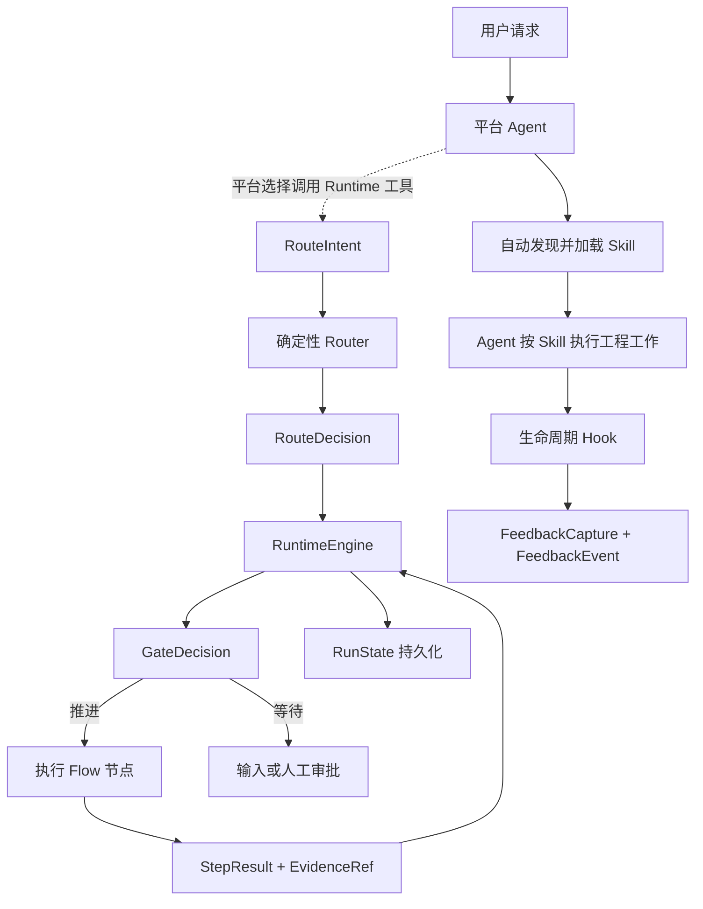

# agent-skills

`agent-skills` 是 `engineering-assistant` 插件的统一作者源，为 Codex 和 Hermes 提供可组合、可恢复、可验证的工程协作能力。

- 当前版本：`1.0.0.0-rc.1`
- 开发者：`sunliming625@gmail.com`
- 运行平台：Codex、Hermes
- 开发语言：Python 3.9+
- 默认语言：简体中文，同时保留中英文任务路由能力

## 项目定位

本项目不把研发流程拆成大量需要用户记忆的阶段命令，而是将能力划分为四层：

1. 公开 skill：面向用户和模型的稳定工程原语。
2. 内部 flow：组织多步骤任务的有向无环图。
3. capability/policy pack：只在相关领域进入范围时加载的专业能力和规则。
4. runtime kernel：负责路由、状态、证据、门禁、恢复和平台构建。

目标是让执行过程可预测，而不是把输出固定成模板。Agent 负责语义判断和工程工作，运行时负责确定性状态与安全边界。

## 快速开始

### 普通用户

已经安装插件时，不需要执行 `pip install` 或手动维护 `ea` 状态机，直接在 Codex App 或 Hermes 中用自然语言描述任务即可。例如：

```text
请先梳理当前仓库上下文，再给出最小充分的实现方案。
基于代码证据诊断这个问题，说明根因、影响和验证结果。
评审当前变更是否同时符合仓库规范和原始需求。
```

Codex 可以根据 skill 的名称和描述自动选择能力，也可以通过 `$repo-context`、`$diagnosing-bugs`、`$code-review` 等名称显式调用。Hermes 可以通过自然语言选择 skill，也可以使用限定名：

```bash
hermes --skills engineering-assistant:repo-context
```

### 从仓库安装到本机

先执行无副作用预演，再显式确认本机发布：

```bash
python3 scripts/publish_local.py --platform codex --dry-run
python3 scripts/publish_local.py --platform codex --yes

python3 scripts/publish_local.py --platform hermes --dry-run
python3 scripts/publish_local.py --platform hermes --yes
```

同时安装两个平台时，将 `--platform` 改为 `all`。发布脚本会完成测试、评测、构建、摘要校验、备份、原子替换、平台注册和安装后验证。详细行为见 [本机发布](docs/operations/local-publish.md)。

### 当前平台集成边界

当前发布包会自动注册 11 个公开 skill，并将同一 Runtime 控制面接入平台：Codex 通过包内 `.mcp.json` 启动 stdio MCP，Hermes 通过插件工具注册复用相同 `RuntimeTools`。两个 adapter 也会注册共享的反馈采集器：Codex 使用 `Stop` 与 `UserPromptSubmit`，Hermes 使用 `post_llm_call`。

| 能力 | 当前行为 |
| --- | --- |
| 发现并选择公开 skill | 平台可根据任务隐式选择，也支持用户显式指定 |
| 加载 `SKILL.md` 和按需参考资料 | 选择 skill 后由平台完成 |
| `route/start/next/complete` | 平台可作为工具调用；`start` 接收 intent 并在服务端重算路由，选择 skill 本身不会隐式启动状态机 |
| 人工审批与调研选择 | 只接受 profile 固定 HTTPS broker 验证的 opaque grant；不存在自由文本 `approve` CLI |
| `RunState` 持久化、DAG 推进和 Runtime 门禁 | 平台调用 Runtime 工具后生效，状态只写入目标项目 `.run-artifacts/engineering-assistant/` |
| Hook 反馈采集 | 每轮记录无原文 capture 元数据；只把阻断、失败、返工、人工纠正和范围追加提升为 `FeedbackEvent` |
| `ea validate/artifact-validate/eval/build/verify-package/canary-validate` | 由开发者、CI 或发布维护者执行 |

所以，当前产品体验是“平台选择 skill，必要时调用 Runtime 工具进入受治理运行，并由生命周期 Hook 采集反馈候选”。只有出现实际 Runtime 工具调用和落盘状态，才能声称状态机、证据门禁或恢复机制已运行。聊天中的“同意”不会自动转换为签名 grant。Codex 的插件 Hook 在用户审查并信任当前定义前会被跳过。

## 核心设计

- 单一事实源：skill、flow、policy、pack、provider 和 profile 的机器定义只存在于 `catalog/`。
- 渐进加载：公开 skill 只加载当前分支需要的 `references/` 和 pack，避免上下文膨胀。
- 可验证完成：flow 节点通过 `StepResult`、完成条件和 `EvidenceRef` 判断是否推进。
- 确定性门禁：高风险动作、审批、证据时效和状态转换由 runtime 执行。
- 可恢复运行：`RunState` 持久化当前节点、revision、审批和阻断原因，可在进程中断后继续。
- 平台无关核心：Codex 与 Hermes 共用相同 catalog、skills、packs、schemas 和 runtime，仅 adapter 不同。
- 无生成镜像：仓库不保存发布包或大面积派生副本，发布时从作者源临时构建。

## 仓库结构

```text
agent-skills/
├── catalog/                    # Skill、Flow、Policy、Pack、Capability、Provider、Profile
├── skills/                     # 11 个公开 skill 及按需 references
├── packs/                      # 9 个专业能力与策略包
├── schemas/                    # 核心协议 JSON Schema
├── src/engineering_assistant/  # 路由、状态机、证据、编译器和平台 adapter
├── evals/                      # Routing、Behavior、State、Replay、Canary
├── tests/                      # 单元、行为、构建、发布和仓库治理测试
├── scripts/                    # 本机 Codex/Hermes 发布入口
├── config/                     # 当前本机发布策略
├── docs/architecture/          # 当前架构说明
├── docs/operations/            # 当前运维说明
├── VERSIONING.md               # 四段式版本规范
└── pyproject.toml              # Python 包与 ea CLI 配置
```

作者源职责：

| 变更内容 | 修改位置 |
| --- | --- |
| Skill 触发和完成语义 | `catalog/skills/` 与 `skills/` |
| Flow 节点和依赖 | `catalog/flows/` |
| 安全、审批和证据规则 | `catalog/policies/` |
| 专业领域能力 | `catalog/packs/` 与 `packs/` |
| 能力提供方及供应链约束 | `catalog/providers/` |
| 公共数据协议 | `schemas/` 与 `model.py` |
| 路由和状态转换 | `router.py`、`engine.py`、`state_store.py` |
| 平台输出 | `adapters/codex.py`、`adapters/hermes.py` |
| 本机发布行为 | `local_publish.py`、`scripts/publish_local.py` |

## 公开 Skills

| Skill | 用途 |
| --- | --- |
| `engineering-assistant` | 将复杂工程请求路由到最小充分的 skill 或 flow |
| `research` | 基于一手资料研究外部项目、API、标准和技术事实 |
| `decision-interview` | 在事实调查后收敛范围、取舍和验收决策 |
| `domain-modeling` | 澄清领域术语、关系和难以逆转的决策 |
| `repo-context` | 从源码提取模块、接口、数据、依赖和影响范围 |
| `wayfinder` | 管理大型任务的目标、当前前沿和待决事项 |
| `prototype` | 用可丢弃的逻辑或界面原型回答一个设计问题 |
| `codebase-design` | 设计深模块、小接口、真实 seam 和局部化变更 |
| `tdd` | 以红绿循环和纵向切片实现已确认行为 |
| `diagnosing-bugs` | 通过复现、假设、定向观测和回归证据诊断问题 |
| `code-review` | 分别按仓库规范和原始需求评审固定 diff |

每个 skill 的 `SKILL.md` 只保留 `name`、`description` 和必要执行规则；专项资料放在同目录 `references/` 中按需加载。

## 内部 Flows

| Flow | 节点 |
| --- | --- |
| `shape` | 事实调查 → 决策收敛 → 需求契约 |
| `design` | 仓库上下文 → 条件化原型 → 架构 → 实现契约 → 设计评审 |
| `implement` | 选择切片 → 红绿循环 → 实现 → 质量证据 → 代码评审 |
| `review` | 固定比较点 → 代码评审/设计评审 → 结论门禁 |
| `release` | 发布就绪 → 发布验证 → 复盘 |
| `evolve` | 反馈摄取 → 知识提炼 → 候选变更 → 质量审计 |

Flow 不是提示词清单。`RuntimeEngine` 会消费 DAG、计算下一节点、检查审批和证据，并将状态持久化到目标项目。

## 能力与策略 Packs

| Pack | 激活条件 |
| --- | --- |
| `frontend-product` | 浏览器或应用用户体验发生变化 |
| `database` | Schema、查询、索引、事务或数据修复进入范围 |
| `redis` | Redis key、缓存、锁或失效逻辑发生变化 |
| `mq` | Topic、消息体、生产消费、重试或回放发生变化 |
| `quality-evidence` | 实现、评审或发布需要声明完成 |
| `document-governance` | 创建、提升或废弃正式项目文档 |
| `release-safety` | 进入发布就绪、验证、回滚或生产观察 |
| `feedback-evolution` | 反馈可能改变 skill、flow、policy 或 eval |
| `team-standards` | 仓库或项目 profile 提供团队规则 |

Policy 优先级为：不可豁免安全规则 → 项目 profile → flow → skill → task override。降低安全等级必须有明确授权，不可豁免规则不能被 override。

### 外部 UI/UX Provider

前端审美、反模板化规则和评审方法融合进原生 `frontend-product` pack；可执行设计知识不复制进核心，而是通过固定来源 Provider 调用。当前 `ui-ux-pro-max` Provider 固定到 MIT 许可的 revision `3da52ff1cab1be91848072ec1be5f493d730fd5f` 及 bundle 摘要，只为 `frontend-design` 和 `product-prototype-review` 提供只读建议。

`engineering_assistant_provider_invoke` 可接收外部 bundle 路径；宿主也可通过 `ENGINEERING_ASSISTANT_UI_UX_PRO_MAX_ROOT` 固定受信路径。执行器拒绝 symlink、pyc、特殊文件、超深/超量目录和超限体积，把普通文件复制到私有快照并对快照验证摘要，再从快照执行。子进程不使用 shell、不传 HOME/代理环境、不使用 `--persist`；macOS 沙箱以 `deny default` 为基线，只放行系统运行时、固定 Python 运行时、私有快照与工作目录读取，禁止网络、fork、额外 exec 和工作目录外写入，并限制时间、进程组和输出文件；没有等价最小权限沙箱的平台安全回退原生能力。bundle 缺失、被篡改、超时或执行失败时返回 `fallback` 与明确的原生执行指令。完整 invocation claim 与结果分别不可变审计到当前 run 的 `providers/`，同 ID 不同输入会冲突，同请求并发只允许 first writer 执行；first writer 崩溃且执行租约到期后，仅一个 CAS 接管者可以恢复。Provider 输出固定标记为 `untrusted_advisory`，不是 `observed` evidence，不能直接完成节点或绕过质量门禁。

## 运行机制



默认运行状态写入目标项目：

```text
.run-artifacts/engineering-assistant/
```

反馈 capture 和候选事件分别写入该目录下的 `feedback/captures/` 与 `feedback/events/`。默认只保存内容摘要、长度、脱敏计数和最多 512 字符的脱敏信号片段，不读取不稳定的 transcript 格式。环境变量 `ENGINEERING_ASSISTANT_FEEDBACK_MODE` 支持：

- `candidates`：默认模式，保存 capture 并提升有效反馈候选。
- `metadata`：只保存 capture 元数据。
- `disabled`：关闭反馈写入。

核心协议包括：

- `SkillSpec`：公开 skill 的触发、能力、完成条件和上下文指针。
- `RouteIntent` / `RouteDecision`：结构化意图和确定性路由结果。
- `FlowSpec`：节点、依赖、条件和完成标准。
- `PolicySpec`：规则、优先级、可覆盖性和违规动作。
- `RunState`：绑定 profile 的运行状态、当前节点、revision、审批和阻断信息。
- `StepResult`：节点执行结果和逐项完成条件。
- `GateDecision`：推进、等待输入、等待审批、重试或阻断。
- `EvidenceRef`：源码、测试、CI、浏览器或外部状态证据。
- `CapabilityProviderSpec`：能力提供方、执行模式、固定来源、风险、网络和失败策略。
- `FeedbackEvent`：问题、阻断、人工修正和可复用候选的结构化反馈。
- `FeedbackCapture`：每轮 Hook 是否执行、内容摘要、脱敏计数和候选事件引用。
- `QualitySnapshot`：正确性、复杂度、冗余、性能、架构和测试质量的证据快照。
- `InvestigationRequest`：Agent 主动调研的问题、模式、成本、停止条件和证据要求。
- `InvestigationRecord`：调研的人工选择引用、状态迁移、结果证据和 revision。

## Runtime 集成与开发者 CLI

`ea` 是 Runtime、调试、评测和发布接口，不是普通 Codex App/Hermes 用户的日常操作界面。仅在开发仓库、直接调试内核或编写平台集成时安装开发包：

```bash
python3 -m pip install -e .
```

命令分为两组：

| 分组 | 命令 | 用途 |
| --- | --- | --- |
| Runtime 控制面 | `route`、`start`、`next`、`complete`、`quality-submit`、`evidence-import`、`investigation-*`、`mcp-serve` | 供平台 adapter、受信执行器和内核调试调用 |
| 研发与发布 | `validate`、`artifact-validate`、`eval`、`build`、`verify-package`、`canary-validate` | 供开发者、CI 和发布门禁调用 |

完整命令语义：

```text
ea route             RouteIntent -> RouteDecision
ea start             创建并持久化 RunState
ea next              计算下一节点和 GateDecision
ea complete          提交 StepResult 和模型 evidence claim
ea approval-import   导入绑定 run、revision 和 scope 的外部审批 grant
ea quality-submit    提交六维代码质量快照
ea evidence-import   导入由宿主执行器签发的证据
ea investigation-propose  创建主动调研提议
ea investigation-list     查看调研队列
ea investigation-approval-import  导入外部审批 broker 的签名选择
ea investigation-start    启动已批准调研
ea investigation-finish   以已登记证据结束调研
ea mcp-serve         以 MCP stdio 暴露含受治理 Provider 调用的受限 Runtime 工具
ea validate          校验 catalog、schema、引用和作者源
ea artifact-validate 使用当前 Runtime schema 校验 step-result、quality-snapshot 等 artifact
ea eval              执行真实核心评测
ea build             构建 Codex 或 Hermes 包
ea verify-package    校验包文件摘要
ea canary-validate   通过外部 evidence broker 校验真实产品 canary 结果
```

自然语言到 `RouteIntent` 的理解由平台 Agent 完成；核心 Router 只消费结构化输入，`start` 必须在服务端重新计算决策，不能接受调用方构造的 `RouteDecision`。Codex MCP 与 Hermes 工具注册都调用同一个 `RuntimeTools`，不会形成并行路由器；模型工具集合不包含审批、自由文本决定或可信证据导入，后续调用必须使用 RunState 已绑定的 profile。

实现流的强制 `quality` 节点只有在六个质量维度全部为 `pass`、没有 medium 以上 finding、没有未关闭修复项且每个判断引用宿主签发的兼容证据时才能完成。质量快照绑定 run revision、候选源码证据摘要和一小时新鲜度；候选内容改变后旧快照自动失效。模型提交的证据输入固定降级为 `claimed`，不能自行设置 `observed` 或 `verified`。

主动调研的最终模式来自 profile 预授权或外部审批 broker，而不是模型建议。`disabled` 直接拒绝；`auto_readonly` 仅在 profile 已授权的资料范围和成本内自动运行；`suggest_then_run` 使用一次 broker grant；`guided` 每次只批准一个资料范围，完成后若仍有资料源则重新进入 proposed。通用高风险审批同样只接受绑定 run、revision、flow、approval、actor 和有效期的 opaque grant。可信证据 receipt 与审批 token 必须由 profile 固定的 HTTPS introspection endpoint 验证，发布包不含签发器或私钥；未配置 broker 时保持等待，不回退到自由文本放行。

本地 artifact 防护面向静态路径逃逸、意外覆盖和协作进程并发，不把同一 OS 用户下的任意代码执行视为可由 JSON 存储层抵御的攻击。生产环境必须由平台沙箱限制 Agent 对插件、profile 和 `.run-artifacts` 的直接篡改，并由外部 broker/Provider 对真正的外部动作再次验签；未具备这些宿主条件时只能声明 Runtime 协议门禁，不能声明安全隔离。

阶段完成默认由子 Agent 分别进行需求/架构评审和代码质量/安全评审，主 Agent 自动修复并复验。只有生产、发布、提交/推送、破坏性变更、安全降级、范围扩张、不可逆产品决策或证据充分后仍无法消除的评审冲突才请求人工判断。

## 开发与验证

完整验证：

```bash
python3 -m unittest discover -s tests -v
ea validate --require-sources
ea eval
python3 scripts/publish_local.py --platform all --dry-run
```

临时构建必须输出到仓库外：

```bash
ea build --platform codex --output /tmp/engineering-assistant-codex
ea verify-package --package /tmp/engineering-assistant-codex

ea build --platform hermes --output /tmp/engineering-assistant-hermes
ea verify-package --package /tmp/engineering-assistant-hermes
```

质量门槛：

- Routing eval 至少 100 条真实中英文任务。
- Top-1 准确率不低于 90%。
- 无结果率不高于 5%。
- 未确认高风险写入为 0。
- Simulation 不得作为真实产品收益证据。
- Codex 和 Hermes 必须从同一作者源构建并通过摘要校验。

## 本机发布

无副作用预演：

```bash
python3 scripts/publish_local.py --platform codex --dry-run
python3 scripts/publish_local.py --platform hermes --dry-run
python3 scripts/publish_local.py --platform all --dry-run
```

实际发布需要显式 `--yes`，并读取当前本机发布策略 `config/local-publish-policy.json`：

```bash
python3 scripts/publish_local.py --platform codex --yes
python3 scripts/publish_local.py --platform hermes --yes
python3 scripts/publish_local.py --platform all --yes
```

脚本自动执行：仓库测试 → 真实 eval → 平台构建 → 包摘要校验 → 旧插件备份 → 原子替换 → 平台注册 → 安装后验证。失败时自动恢复旧插件。

- Codex：安装到 `~/plugins/engineering-assistant`，维护 personal marketplace 并刷新 Codex 缓存。
- Hermes：安装到 `~/.hermes/plugins/engineering-assistant`，调用 `hermes plugins enable engineering-assistant`。

平台 CLI 按“显式环境变量 → `PATH` → macOS App 内置路径”的顺序发现。Codex App 安装在标准目录时，无需额外配置；自定义位置可以显式指定：

```bash
CODEX_CLI="/自定义路径/codex" python3 scripts/publish_local.py --platform codex --yes
HERMES_CLI="/自定义路径/hermes" python3 scripts/publish_local.py --platform hermes --yes
```

详细说明见 [本机发布](docs/operations/local-publish.md)。

## 版本规则

产品使用四段式版本：

```text
MAJOR.MINOR.PATCH.BUILD[-PRERELEASE]
```

平台只支持 SemVer 时，由 adapter 将四段式版本映射为 SemVer，并在 `package-manifest.json` 中保留 canonical version。详见 [VERSIONING.md](VERSIONING.md)。

## 安全边界

- 高风险写入、生产动作、发布、删除历史和降低安全等级必须由用户明确授权。
- `--dry-run` 不写入插件目录、marketplace 或平台配置。
- `--yes` 只允许本机预发布；当前策略禁止稳定版发布和产品仓库修改。
- 发布脚本始终保留直接回滚目录，不静默删除旧插件。
- 没有真实运行证据时，不得声明产品 canary 或收益目标已完成。Canary 至少包含 5 组 workload 摘要一致的 baseline/candidate，result 固定声明两侧 execution config 摘要且配对环境摘要必须一致；每条 observation 由 profile 配置的外部 evidence broker 完整验签，并校验本地证据根内 artifact 摘要。token 降幅与实际美元成本降幅分开计算。默认 profile 未配置 broker，因此会安全拒绝 canary 结果。
- 失败门禁不能用文字说明替代，必须修复或保持阻断。
- 反馈 Hook 默认不阻断任务、不自动继续 Stop，也不自动修改正式 skill、flow、policy 或 eval。
- Hook 不保存原始 transcript、session id 或 turn id；检测到凭证和邮箱时先脱敏，并拒绝通过符号链接把反馈写出项目目录。

## 文档

- [当前架构](docs/architecture/overview.md)
- [本机发布](docs/operations/local-publish.md)
- [版本规范](VERSIONING.md)
