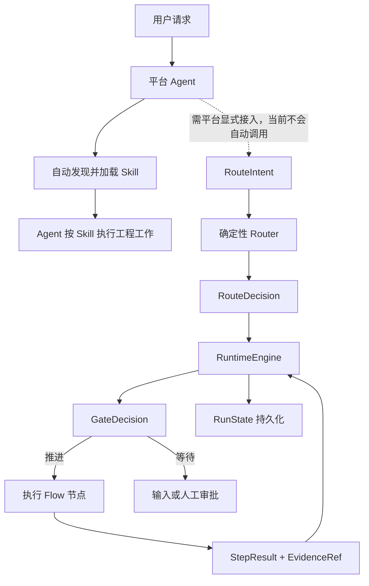

# agent-skills

`agent-skills` 是 `engineering-assistant` 插件的统一作者源，为 Codex 和 Hermes 提供可组合、可恢复、可验证的工程协作能力。

- 当前版本：`1.0.0.0-rc.1`
- 开发者：`sunliming625@gmail.com`
- 运行平台：Codex、Hermes
- 开发语言：Python 3.9+
- 默认语言：简体中文，同时保留中英文任务路由能力

## 项目定位

本项目不把研发流程拆成大量需要用户记忆的阶段命令，而是将能力划分为四层：

1. 公开 skill：面向用户和模型的稳定工程原语。
2. 内部 flow：组织多步骤任务的有向无环图。
3. capability/policy pack：只在相关领域进入范围时加载的专业能力和规则。
4. runtime kernel：负责路由、状态、证据、门禁、恢复和平台构建。

目标是让执行过程可预测，而不是把输出固定成模板。Agent 负责语义判断和工程工作，运行时负责确定性状态与安全边界。

## 快速开始

### 普通用户

已经安装插件时，不需要执行 `pip install` 或手动维护 `ea` 状态机，直接在 Codex App 或 Hermes 中用自然语言描述任务即可。例如：

```text
请先梳理当前仓库上下文，再给出最小充分的实现方案。
基于代码证据诊断这个问题，说明根因、影响和验证结果。
评审当前变更是否同时符合仓库规范和原始需求。
```

Codex 可以根据 skill 的名称和描述自动选择能力，也可以通过 `$repo-context`、`$diagnosing-bugs`、`$code-review` 等名称显式调用。Hermes 可以通过自然语言选择 skill，也可以使用限定名：

```bash
hermes --skills engineering-assistant:repo-context
```

### 从仓库安装到本机

先执行无副作用预演，再显式确认本机发布：

```bash
python3 scripts/publish_local.py --platform codex --dry-run
python3 scripts/publish_local.py --platform codex --yes

python3 scripts/publish_local.py --platform hermes --dry-run
python3 scripts/publish_local.py --platform hermes --yes
```

同时安装两个平台时，将 `--platform` 改为 `all`。发布脚本会完成测试、评测、构建、摘要校验、备份、原子替换、平台注册和安装后验证。详细行为见 [本机发布](docs/operations/local-publish.md)。

### 当前平台集成边界

当前发布包会自动注册 11 个公开 skill，但还没有把 `ea` Runtime 注册为 Codex/Hermes 的 MCP 工具、Hook 或平台工具。因此必须区分两种能力：

| 能力 | 当前行为 |
| --- | --- |
| 发现并选择公开 skill | 平台可根据任务隐式选择，也支持用户显式指定 |
| 加载 `SKILL.md` 和按需参考资料 | 选择 skill 后由平台完成 |
| `ea route/start/next/complete/approve` | 不会因选择 skill 而自动执行 |
| `RunState` 持久化、DAG 推进和 Runtime 门禁 | 仅在集成方显式调用 Runtime 时生效 |
| `ea validate/eval/build/verify-package/canary-validate` | 由开发者、CI 或发布维护者执行 |

所以，当前默认产品体验是“平台自动选择 skill，Agent 按 skill 工作”；Runtime kernel 已可独立调用和测试，但尚未成为 Codex/Hermes 的自动任务控制面。聊天中的“同意”也不会自动转换为 `ea approve`。在平台 adapter 完成 Runtime 工具接入前，不得把仅执行 skill 提示描述成已经运行了状态机、证据门禁或恢复机制。

## 核心设计

- 单一事实源：skill、flow、policy、pack 和 profile 的机器定义只存在于 `catalog/`。
- 渐进加载：公开 skill 只加载当前分支需要的 `references/` 和 pack，避免上下文膨胀。
- 可验证完成：flow 节点通过 `StepResult`、完成条件和 `EvidenceRef` 判断是否推进。
- 确定性门禁：高风险动作、审批、证据时效和状态转换由 runtime 执行。
- 可恢复运行：`RunState` 持久化当前节点、revision、审批和阻断原因，可在进程中断后继续。
- 平台无关核心：Codex 与 Hermes 共用相同 catalog、skills、packs、schemas 和 runtime，仅 adapter 不同。
- 无生成镜像：仓库不保存发布包或大面积派生副本，发布时从作者源临时构建。

## 仓库结构

```text
agent-skills/
├── catalog/                    # Skill、Flow、Policy、Pack、Capability、Profile
├── skills/                     # 11 个公开 skill 及按需 references
├── packs/                      # 9 个专业能力与策略包
├── schemas/                    # 核心协议 JSON Schema
├── src/engineering_assistant/  # 路由、状态机、证据、编译器和平台 adapter
├── evals/                      # Routing、Behavior、State、Replay、Canary
├── tests/                      # 单元、行为、构建、发布和仓库治理测试
├── scripts/                    # 本机 Codex/Hermes 发布入口
├── config/                     # 当前本机发布策略
├── docs/architecture/          # 当前架构说明
├── docs/operations/            # 当前运维说明
├── VERSIONING.md               # 四段式版本规范
└── pyproject.toml              # Python 包与 ea CLI 配置
```

作者源职责：

| 变更内容 | 修改位置 |
| --- | --- |
| Skill 触发和完成语义 | `catalog/skills/` 与 `skills/` |
| Flow 节点和依赖 | `catalog/flows/` |
| 安全、审批和证据规则 | `catalog/policies/` |
| 专业领域能力 | `catalog/packs/` 与 `packs/` |
| 公共数据协议 | `schemas/` 与 `model.py` |
| 路由和状态转换 | `router.py`、`engine.py`、`state_store.py` |
| 平台输出 | `adapters/codex.py`、`adapters/hermes.py` |
| 本机发布行为 | `local_publish.py`、`scripts/publish_local.py` |

## 公开 Skills

| Skill | 用途 |
| --- | --- |
| `engineering-assistant` | 将复杂工程请求路由到最小充分的 skill 或 flow |
| `research` | 基于一手资料研究外部项目、API、标准和技术事实 |
| `decision-interview` | 在事实调查后收敛范围、取舍和验收决策 |
| `domain-modeling` | 澄清领域术语、关系和难以逆转的决策 |
| `repo-context` | 从源码提取模块、接口、数据、依赖和影响范围 |
| `wayfinder` | 管理大型任务的目标、当前前沿和待决事项 |
| `prototype` | 用可丢弃的逻辑或界面原型回答一个设计问题 |
| `codebase-design` | 设计深模块、小接口、真实 seam 和局部化变更 |
| `tdd` | 以红绿循环和纵向切片实现已确认行为 |
| `diagnosing-bugs` | 通过复现、假设、定向观测和回归证据诊断问题 |
| `code-review` | 分别按仓库规范和原始需求评审固定 diff |

每个 skill 的 `SKILL.md` 只保留 `name`、`description` 和必要执行规则；专项资料放在同目录 `references/` 中按需加载。

## 内部 Flows

| Flow | 节点 |
| --- | --- |
| `shape` | 事实调查 → 决策收敛 → 需求契约 |
| `design` | 仓库上下文 → 条件化原型 → 架构 → 实现契约 → 设计评审 |
| `implement` | 选择切片 → 红绿循环 → 实现 → 质量证据 → 代码评审 |
| `review` | 固定比较点 → 代码评审/设计评审 → 结论门禁 |
| `release` | 发布就绪 → 发布验证 → 复盘 |
| `evolve` | 反馈摄取 → 知识提炼 → 候选变更 → 质量审计 |

Flow 不是提示词清单。`RuntimeEngine` 会消费 DAG、计算下一节点、检查审批和证据，并将状态持久化到目标项目。

## 能力与策略 Packs

| Pack | 激活条件 |
| --- | --- |
| `frontend-product` | 浏览器或应用用户体验发生变化 |
| `database` | Schema、查询、索引、事务或数据修复进入范围 |
| `redis` | Redis key、缓存、锁或失效逻辑发生变化 |
| `mq` | Topic、消息体、生产消费、重试或回放发生变化 |
| `quality-evidence` | 实现、评审或发布需要声明完成 |
| `document-governance` | 创建、提升或废弃正式项目文档 |
| `release-safety` | 进入发布就绪、验证、回滚或生产观察 |
| `feedback-evolution` | 反馈可能改变 skill、flow、policy 或 eval |
| `team-standards` | 仓库或项目 profile 提供团队规则 |

Policy 优先级为：不可豁免安全规则 → 项目 profile → flow → skill → task override。降低安全等级必须有明确授权，不可豁免规则不能被 override。

## 运行机制



默认运行状态写入目标项目：

```text
.run-artifacts/engineering-assistant/
```

核心协议包括：

- `SkillSpec`：公开 skill 的触发、能力、完成条件和上下文指针。
- `RouteIntent` / `RouteDecision`：结构化意图和确定性路由结果。
- `FlowSpec`：节点、依赖、条件和完成标准。
- `PolicySpec`：规则、优先级、可覆盖性和违规动作。
- `RunState`：运行状态、当前节点、revision、审批和阻断信息。
- `StepResult`：节点执行结果和逐项完成条件。
- `GateDecision`：推进、等待输入、等待审批、重试或阻断。
- `EvidenceRef`：源码、测试、CI、浏览器或外部状态证据。

## Runtime 集成与开发者 CLI

`ea` 是 Runtime、调试、评测和发布接口，不是普通 Codex App/Hermes 用户的日常操作界面。仅在开发仓库、直接调试内核或编写平台集成时安装开发包：

```bash
python3 -m pip install -e .
```

命令分为两组：

| 分组 | 命令 | 用途 |
| --- | --- | --- |
| Runtime 控制面 | `route`、`start`、`next`、`complete`、`approve` | 供平台 adapter、自动化集成和内核调试调用 |
| 研发与发布 | `validate`、`eval`、`build`、`verify-package`、`canary-validate` | 供开发者、CI 和发布门禁调用 |

完整命令语义：

```text
ea route             RouteIntent -> RouteDecision
ea start             创建并持久化 RunState
ea next              计算下一节点和 GateDecision
ea complete          提交 StepResult 和 EvidenceRef
ea approve           授予有时效的人工审批
ea validate          校验 catalog、schema、引用和作者源
ea eval              执行真实核心评测
ea build             构建 Codex 或 Hermes 包
ea verify-package    校验包文件摘要
ea canary-validate   校验真实产品 canary 结果
```

自然语言到 `RouteIntent` 的理解由平台 Agent 完成；核心 Router 只消费结构化输入，避免把模型分类结果伪装成确定性规则。发布包内会包含独立的 `engineering-assistant/bin/ea` 启动器，但当前 Codex/Hermes adapter 只注册 skill，不会自动调用该启动器。

## 开发与验证

完整验证：

```bash
python3 -m unittest discover -s tests -v
ea validate --require-sources
ea eval
python3 scripts/publish_local.py --platform all --dry-run
```

临时构建必须输出到仓库外：

```bash
ea build --platform codex --output /tmp/engineering-assistant-codex
ea verify-package --package /tmp/engineering-assistant-codex

ea build --platform hermes --output /tmp/engineering-assistant-hermes
ea verify-package --package /tmp/engineering-assistant-hermes
```

质量门槛：

- Routing eval 至少 100 条真实中英文任务。
- Top-1 准确率不低于 90%。
- 无结果率不高于 5%。
- 未确认高风险写入为 0。
- Simulation 不得作为真实产品收益证据。
- Codex 和 Hermes 必须从同一作者源构建并通过摘要校验。

## 本机发布

无副作用预演：

```bash
python3 scripts/publish_local.py --platform codex --dry-run
python3 scripts/publish_local.py --platform hermes --dry-run
python3 scripts/publish_local.py --platform all --dry-run
```

实际发布需要显式 `--yes`，并读取当前本机发布策略 `config/local-publish-policy.json`：

```bash
python3 scripts/publish_local.py --platform codex --yes
python3 scripts/publish_local.py --platform hermes --yes
python3 scripts/publish_local.py --platform all --yes
```

脚本自动执行：仓库测试 → 真实 eval → 平台构建 → 包摘要校验 → 旧插件备份 → 原子替换 → 平台注册 → 安装后验证。失败时自动恢复旧插件。

- Codex：安装到 `~/plugins/engineering-assistant`，维护 personal marketplace 并刷新 Codex 缓存。
- Hermes：安装到 `~/.hermes/plugins/engineering-assistant`，调用 `hermes plugins enable engineering-assistant`。

平台 CLI 按“显式环境变量 → `PATH` → macOS App 内置路径”的顺序发现。Codex App 安装在标准目录时，无需额外配置；自定义位置可以显式指定：

```bash
CODEX_CLI="/自定义路径/codex" python3 scripts/publish_local.py --platform codex --yes
HERMES_CLI="/自定义路径/hermes" python3 scripts/publish_local.py --platform hermes --yes
```

详细说明见 [本机发布](docs/operations/local-publish.md)。

## 版本规则

产品使用四段式版本：

```text
MAJOR.MINOR.PATCH.BUILD[-PRERELEASE]
```

平台只支持 SemVer 时，由 adapter 将四段式版本映射为 SemVer，并在 `package-manifest.json` 中保留 canonical version。详见 [VERSIONING.md](VERSIONING.md)。

## 安全边界

- 高风险写入、生产动作、发布、删除历史和降低安全等级必须由用户明确授权。
- `--dry-run` 不写入插件目录、marketplace 或平台配置。
- `--yes` 只允许本机预发布；当前策略禁止稳定版发布和产品仓库修改。
- 发布脚本始终保留直接回滚目录，不静默删除旧插件。
- 没有真实运行证据时，不得声明产品 canary 或收益目标已完成。
- 失败门禁不能用文字说明替代，必须修复或保持阻断。

## 文档

- [当前架构](docs/architecture/overview.md)
- [本机发布](docs/operations/local-publish.md)
- [版本规范](VERSIONING.md)
