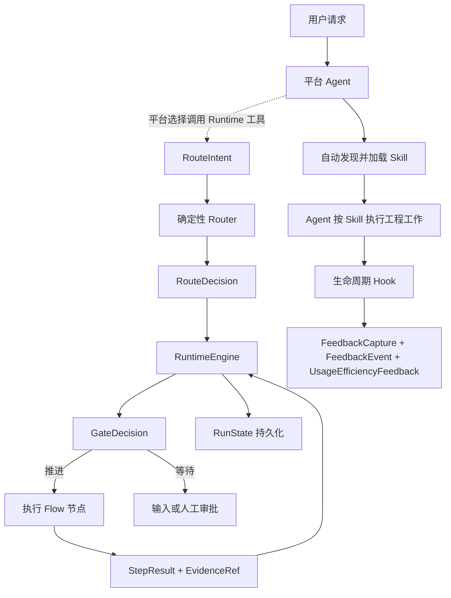

# agent-skills

`agent-skills` 是 `engineering-assistant` 插件的统一作者源，为 Codex、Hermes 和 Claude Code 提供可组合、可恢复、可验证的工程协作能力。

- 当前版本：`1.0.0.1`（正式内部交付候选，尚未推广）
- 开发者：`sunliming625@gmail.com`
- 运行平台：Codex、Hermes、Claude Code
- 内核语言：Python；安装 Runtime 固定 CPython `3.13.13`、PBS `20260414` 分布构建及归档摘要，启动器使用 Rust
- 默认语言：简体中文，同时保留中英文任务路由能力

## 项目定位

本项目不把研发流程拆成大量需要用户记忆的阶段命令，而是将能力划分为四层：

1. 公开 skill：面向用户和模型的稳定工程原语。
2. 内部 flow：组织多步骤任务的有向无环图。
3. capability/policy pack：只在相关领域进入范围时加载的专业能力和规则。
4. runtime kernel：负责路由、状态、证据、门禁、恢复和平台构建。

目标是让执行过程可预测，而不是把输出固定成模板。Agent 负责语义判断和工程工作，运行时负责确定性状态与安全边界。

当前简化重点是安装和维护。小任务可内联完成；正式流程继续由 Runtime 校验阶段完成条件、质量证据、审批范围与 revision，并保留中断恢复和并发保护。`RunState` 是唯一权威运行状态，交接说明从状态与已登记证据生成。Hook 继续作为非阻断观察器，Provider 隔离要求继续保留。

## 快速开始

### 先选择验证目标

| 你现在要做什么 | 准备工作 | 从哪里执行 |
| --- | --- | --- |
| 验证当前仓库和本机 Runtime | 作者源 checkout、Git、uv、Rust 和系统编译工具 | [维护者本地验证](#维护者本地验证)，现在即可执行 |
| 模拟新人安装到 Codex | Codex 登录、uv、Git 和私有仓库访问权限；先有经过核验的发行 tag | [新人安装验收](#新人安装验收)，当前入口待发布 |
| 验收正式内部交付 | 同一候选在 macOS arm64、macOS Intel、Windows 11 x64 上的真实 App、CLI、Provider 证据 | [三目标发行验收](#三目标发行验收) |

现在可以完成本地验证并生成三目标候选输入，无需购买 GitHub CI；具体命令见 [无付费 CI 的候选准备](#无付费-ci-的候选准备)。本地检查通过仍须补齐真实宿主验收和发行推广，不能写成已完成交付。

### 普通用户

已经安装插件时，不需要执行 `pip install` 或手动维护 `ea` 状态机，直接在 Codex App 或 Hermes 中用自然语言描述任务即可。例如：

```text
请先梳理当前仓库上下文，再给出最小充分的实现方案。
基于代码证据诊断这个问题，说明根因、影响和验证结果。
评审当前变更是否同时符合仓库规范和原始需求。
```

Codex 和 Claude Code 可以根据 skill 的名称和描述自动选择能力，也可以显式调用。当前 Hermes 插件 skill 通过产品限定名显式加载，不进入普通 available_skills 索引：

```bash
hermes --skills engineering-assistant:repo-context
```

### 内部 Codex 安装与更新

首次准备完成后，日常安装收敛为：**运行一条命令 → 在 Codex 审查并信任 Hook → 新建会话**。macOS 与 Windows 使用相同的插件命令，安装器自动选择系统、架构、Runtime 和受控本地市场。无需手动安装 Python、Rust、Node，也无需克隆本仓库。

**当前安装入口尚未发布，以下插件安装、更新及检查命令均为发布后的教程。** `1.0.0.1` 尚未完成三目标真实宿主验收与推广；对应源码 tag `internal/installer/1.0.0.1`、发行 tag `internal/codex/1.0.0.1` 和移动入口 `internal/installer` 必须经维护者验收并发布，才能供新人使用。准备 Git、uv 的命令现在可用，不代表插件已经可安装。

#### 1. 首次准备，只做一次

先安装并登录 Codex App 或原生 CLI，取得团队私有仓库的读取权限。首轮支持目标为 macOS 14+（Apple Silicon / Intel）和原生 Windows 11 x64；完整功能包含 11 个 skills、Runtime MCP、Hook 和 Provider 隔离。已经具备 Git、uv 和 Git HTTPS 授权时，直接跳到第 2 步。

**macOS：打开终端，只安装缺少的工具。** 没有 Git 时执行以下命令并完成系统安装窗口；已有 Git 则跳过，不要求为了插件额外安装 Homebrew：

```bash
xcode-select --install
```

没有 uv 时，使用 [uv 官方安装器](https://docs.astral.sh/uv/getting-started/installation/) 安装本项目的首次验证基线：

```bash
curl -LsSf https://astral.sh/uv/0.11.7/install.sh | sh
```

**Windows：打开普通用户 PowerShell，只安装缺少的工具。** 没有 Git 时使用 [Git 官方页面列出的 WinGet 命令](https://git-scm.com/install/windows)，按提示完成安装：

```powershell
winget install --id Git.Git -e --source winget
```

没有 uv 时使用同一版本的官方安装器；参数只作用于本次 PowerShell 子进程，不要求永久更改执行策略：

```powershell
powershell -ExecutionPolicy ByPass -c "irm https://astral.sh/uv/0.11.7/install.ps1 | iex"
```

两种系统安装工具后都关闭并重新打开终端，使 PATH 生效。Git 的获取方式也可参考 [macOS 官方说明](https://git-scm.com/install/mac)。

**私有仓库首次授权：** Git HTTPS 必须可用，浏览器登录 GitHub 不等于 Git 已授权。已有系统凭证时无需重复登录；首次访问可通过以下只读命令触发已配置凭证管理器的浏览器登录，成功应返回 HEAD 引用：

```bash
git ls-remote https://github.com/snbc-qihang/agent-skills.git HEAD
```

Git for Windows 默认包含 Git Credential Manager；macOS 尚未配置凭证助手时，按 [GitHub 的 HTTPS 凭证说明](https://docs.github.com/en/get-started/git-basics/caching-your-github-credentials-in-git) 完成一次授权。凭证助手未安装或未配置时，上述命令不保证弹出浏览器。授权不能由插件代替，命令中无需填写 token；也无需配置提交用的 `user.name` / `user.email`。

#### 2. 发布后安装，两种系统同一条命令

无需进入仓库目录，在 macOS 终端或 Windows PowerShell 执行：

```bash
uvx --isolated --refresh --python 3.13.13 --from "git+https://github.com/snbc-qihang/agent-skills.git@internal/installer/1.0.0.1" ea-setup install --agent codex
```

#### 3. 完成宿主信任并开始使用

出现 `needs_trust` 时，在 Codex 审查并信任当前 Hook 定义，然后新建会话。安装本身不能替用户授予 Hook 信任，详见 [OpenAI Docs](https://developers.openai.com/plugins/build/plugins#bundled-mcp-servers-and-lifecycle-hooks)。在新会话发送“使用 engineering-assistant:repo-context 梳理当前项目”，确认加载插件；如需检查 MCP 与中断恢复，使用下方 [新人安装验收](#新人安装验收)。普通用户无需执行作者测试、构建或发布脚本。

需要安装诊断时执行以下命令；仅在已完成宿主信任后使用 `--hooks-trusted`，它只记录本次声明：

```bash
uvx --isolated --refresh --python 3.13.13 --from "git+https://github.com/snbc-qihang/agent-skills.git@internal/installer/1.0.0.1" ea-setup doctor --agent codex --hooks-trusted --json
```

预期 `status=ready`、`runtime_ready=true`、`provider_ready=true`、`native_activation=enabled`。`needs_trust` 是等待宿主信任，`requires_native_activation` 是等待启用；`partial` 或 `failed` 仍未完成安装资格检查。

#### 4. 发布后更新，只运行一条命令

```bash
uvx --isolated --refresh --python 3.13.13 --from "git+https://github.com/snbc-qihang/agent-skills.git@internal/installer" ea-setup update --agent codex
```

更新后新建会话；Hook 定义变化时重新审查。修复、卸载和详细排障见 [安装与本机发布](docs/operations/local-publish.md)。

`--isolated` 隔离此前安装的同名 tool，`--refresh` 刷新来源；安装器核对实际 Git 来源 commit、同版本发行 tag、验收记录与目标包摘要，准备并核对受控本地市场来源后调用原生 `plugin add` 完成选择。`doctor`、`repair` 和 `uninstall` 使用固定版本的命令前缀。默认输出中文，自动化读取加 `--json`。等待 Hook 审查返回 `needs_trust`，未完全就绪返回退出码 2；用户审查信任并重开会话后再检查。

已有历史 2.x 时，先按检查输出自行卸载旧来源，并清理可确认的历史版本和备份。`doctor --json` 提供 `legacy_installation_detected`、检查范围、确切位置和人工步骤；安装器不自动迁移或删除。共享 personal 市场、共享 Python、其他插件、作者源码和项目运行证据保留。受控 1.x 的正常跨版本更新继续使用 `update`。

仓库保持私有，不需要开源或上架公开插件市场。私有 GitHub Release 提供版本说明和安装教程，安装仍从不可变 Git tag 获取预编译插件。本阶段的正式内部交付资格只证明完整安装与运行验收；产品稳定版和真实收益仍遵守 [Canary 门槛](docs/operations/canary.md)。

安装器发现兼容 Codex 控制 CLI；缺失时按固定官方来源准备完整 `0.159.2` 归档到私有 tools 目录，使用同一个 `CODEX_HOME`，不修改用户 PATH 或 App。Runtime 准备好后以绝对路径启动固定 Python，日常会话不依赖 `uv`、终端 PATH 或环境激活。首次或 Hook 定义变化后仍需在 Codex 中审查并信任 Hook，并重新打开会话；`--hooks-trusted` 只记录本次用户声明，不能替宿主授予信任或证明事件执行。

Hermes、Claude Code 和 Linux 的共享源码及高级 wheel/source 入口保留回归能力，不纳入首轮内部发行资格。Windows Server CI、包构建、单元测试与 `doctor` 都不能代替 Windows 11 和真实已认证 App/CLI 会话验收。高级入口、恢复边界与发行推广流程见 [安装与本机发布](docs/operations/local-publish.md)。

### 作者从仓库安装到本机

当前正式编号仅执行无副作用预演；下面的 `--yes` 流程仅适用于预发布源码。正式内部交付使用上面的受控安装入口：

```bash
python3 scripts/publish_local.py --platform codex --dry-run
python3 scripts/publish_local.py --platform codex --yes

python3 scripts/publish_local.py --platform hermes --dry-run
python3 scripts/publish_local.py --platform hermes --yes

python3 scripts/publish_local.py --platform claude-code --dry-run
python3 scripts/publish_local.py --platform claude-code --yes
python3 scripts/publish_local.py --platform claude-code --verify
```

同时验证三个平台时，将 `--platform` 改为 `all`。预演完成测试、评测、构建和摘要校验；预发布的实际发布另执行固定 Runtime 准备、备份、原子替换、平台注册和安装后验证。详细行为见 [本机发布](docs/operations/local-publish.md)；真实产品收益验证见 [真实产品 Canary](docs/operations/canary.md)。

Claude Code 通过受控本机 marketplace 安装；安装或更新后执行 `/reload-plugins`，或启动新会话：

```bash
python3 scripts/publish_local.py --platform claude-code --dry-run
python3 scripts/publish_local.py --platform claude-code --yes
python3 scripts/publish_local.py --platform claude-code --verify
# 卸载并注销 marketplace（保留受控市场包，便于重新安装）
python3 scripts/publish_local.py --platform claude-code --uninstall --yes
```

### 当前平台集成边界

当前发布包会自动注册 11 个公开 skill，并将同一 Runtime 控制面接入平台：Codex 和 Claude Code 通过包内 `.mcp.json` 启动原生 launcher，再进入固定 Runtime 的 stdio MCP；Hermes 通过只使用标准库的宿主桥调用相同 launcher 和 `RuntimeTools`。Codex 与 Claude Code 注册 `UserPromptSubmit`、`PreToolUse`、`PostToolUse` 与 `Stop`；轻量 gate 只在明确使用插件或项目存在活动 run 时加载观察逻辑，无有效信号不写反馈 artifact。

| 能力 | 当前行为 |
| --- | --- |
| 发现并选择公开 skill | 平台可根据任务隐式选择，也支持用户显式指定 |
| 加载 `SKILL.md` 和按需参考资料 | 选择 skill 后由平台完成 |
| `route/start/next/complete` | 平台可作为工具调用；`start` 接收 intent 并在服务端重算路由，选择 skill 本身不会隐式启动状态机 |
| 人工审批与调研选择 | 记录对话中明确的本地决定；不宣称身份验签，外部高风险动作仍受平台权限确认 |
| `RunState` 持久化、DAG 推进和 Runtime 门禁 | 平台调用 Runtime 工具后生效，状态只写入目标项目 `.run-artifacts/engineering-assistant/` |
| Hook 反馈采集 | 只保存工具失败、人工纠正、blocker、返工或效率信号；优先关联真实 run/task/node，不保存无信号 capture |
| `ea validate/artifact-validate/eval/build/verify-package/canary-audit/canary-prepare/canary-assemble/canary-validate` | 由开发者、CI 或发布维护者执行 |

所以，当前产品体验是“primitive skill 轻量内联，多步骤 flow 默认本地持久化，并由生命周期 Hook 采集有效反馈”。本地记录提供可追溯性，不提供密码学身份或抗篡改保证。Codex 的插件 Hook 在用户审查并信任当前定义前会被跳过。

## 核心设计

- 单一事实源：skill、flow、policy、pack、provider、开源来源决策和 profile 的机器定义只存在于 `catalog/`。
- 渐进加载：公开 skill 只加载当前分支需要的 `references/` 和 pack，避免上下文膨胀。
- 可验证完成：flow 节点通过 `StepResult`、完成条件和 `EvidenceRef` 判断是否推进。
- 确定性门禁：高风险动作、审批、证据时效和状态转换由 runtime 执行。
- 可恢复运行：`RunState` v2 持久化当前节点、revision 和阻断原因；`complete` 先写不可变步骤记录再推进 CAS 状态，中断后可从步骤记录恢复；审批由独立不可变记录计算，可在新对话中发现并继续。
- 平台无关核心：Codex、Hermes 与 Claude Code 共用相同 catalog、skills、packs、schemas 和 runtime，仅 adapter 不同。
- 无生成镜像：仓库不保存发布包或大面积派生副本，发布时从作者源临时构建。

## 仓库结构

```text
agent-skills/
├── catalog/                    # Skill、Flow、Policy、Pack、Provider、来源决策、Profile
├── skills/                     # 11 个公开 skill 及按需 references
├── packs/                      # 9 个专业能力与策略包
├── schemas/                    # 核心协议 JSON Schema
├── src/engineering_assistant/  # 路由、状态机、证据、编译器和平台 adapter
├── evals/                      # Routing、Behavior、State、Replay、Canary
├── tests/                      # 单元、行为、构建、发布和仓库治理测试
├── scripts/                    # 本机发布、安装资格与发行资产组装入口
├── config/                     # 当前本机发布策略
├── docs/architecture/          # 当前架构说明
├── docs/operations/            # 当前运维说明
├── VERSIONING.md               # 四段式版本规范
└── pyproject.toml              # Python 包与 ea CLI 配置
```

作者源职责：

| 变更内容 | 修改位置 |
| --- | --- |
| Skill 触发和完成语义 | `catalog/skills/` 与 `skills/` |
| Flow 节点和依赖 | `catalog/flows/` |
| 安全、审批和证据规则 | `catalog/policies/` |
| 专业领域能力 | `catalog/packs/` 与 `packs/` |
| 能力提供方及供应链约束 | `catalog/providers/` |
| 开源能力采用决策与落点 | `catalog/sources/` |
| 公共数据协议 | `schemas/` 与 `model.py` |
| 路由和状态转换 | `router.py`、`engine.py`、`state_store.py` |
| 平台输出 | `adapters/codex.py`、`adapters/hermes.py` |
| 本机发布行为 | `local_publish.py`、`scripts/publish_local.py` |

## 公开 Skills

| Skill | 用途 |
| --- | --- |
| `engineering-assistant` | 将复杂工程请求路由到最小充分的 skill 或 flow |
| `research` | 基于一手资料研究外部项目、API、标准和技术事实 |
| `decision-interview` | 在事实调查后收敛范围、取舍和验收决策 |
| `domain-modeling` | 建立限界上下文、统一语言、业务规则和战略/战术领域模型 |
| `repo-context` | 从源码提取模块、接口、数据、依赖和影响范围 |
| `wayfinder` | 管理大型任务的目标、当前前沿和待决事项 |
| `prototype` | 用可丢弃的逻辑或界面原型回答一个设计问题 |
| `codebase-design` | 设计深模块、小接口、真实 seam 和局部化变更 |
| `tdd` | 以红绿循环和纵向切片实现已确认行为 |
| `diagnosing-bugs` | 通过复现、假设、定向观测和回归证据诊断问题 |
| `code-review` | 分别按仓库规范和原始需求评审固定 diff |

每个 skill 的 `SKILL.md` 只保留 `name`、`description` 和必要执行规则；专项资料放在同目录 `references/` 中按需加载。

## 内部 Flows

| Flow | 节点 |
| --- | --- |
| `shape` | 事实调查 → 决策收敛 → 需求契约 |
| `design` | 仓库上下文 → 条件化原型 → 架构 → 实现契约 → 设计评审 |
| `implement` | 选择切片 → 红绿循环 → 实现 → 质量证据 → 代码评审 |
| `review` | 固定比较点 → 代码评审/设计评审 → 结论门禁 |
| `release` | 发布就绪 → 发布验证 → 复盘 |
| `evolve` | 反馈摄取 → 知识提炼 → 候选变更 → 质量审计 |

Flow 不是提示词清单。`RuntimeEngine` 会消费 DAG、计算下一节点、检查审批和证据，并将状态持久化到目标项目。

## 能力与策略 Packs

| Pack | 激活条件 |
| --- | --- |
| `frontend-product` | 浏览器或应用用户体验发生变化 |
| `database` | Schema、查询、索引、事务或数据修复进入范围 |
| `redis` | Redis key、缓存、锁或失效逻辑发生变化 |
| `mq` | Topic、消息体、生产消费、重试或回放发生变化 |
| `quality-evidence` | 实现、评审或发布需要声明完成 |
| `document-governance` | 创建、提升或废弃正式项目文档 |
| `release-safety` | 进入发布就绪、验证、回滚或生产观察 |
| `feedback-evolution` | 反馈可能改变 skill、flow、policy 或 eval |
| `team-standards` | 仓库或项目 profile 提供团队规则 |

Policy 优先级为：不可豁免安全规则 → 项目 profile → flow → skill → task override。降低安全等级必须有明确授权，不可豁免规则不能被 override。

### 外部 UI/UX Provider

六个评估来源的当前决策由 `catalog/sources/open-source.json` 机器校验：Anthropic Skills、Superpowers、Addy Osmani Agent Skills 与 Taste Skill 只融合规范或工程原则；UI/UX Pro Max 作为固定 revision、摘要和许可证的外部 Provider；UX/UI Agent Skills 因能力重叠且没有足以抵消上下文、供应链和维护成本的独立增量而不导入。每项记录都绑定 reviewed revision、许可证证据、代表性上游路径和本仓库落点；`fuse` 不表示复制整个上游仓库，`not_adopted` 也不会在运行时加载其资产。

前端审美、反模板化规则和评审方法融合进原生 `frontend-product` pack；可执行设计知识不复制进核心，而是通过固定来源 Provider 调用。当前 `ui-ux-pro-max` Provider 固定到 MIT 许可的 revision `3da52ff1cab1be91848072ec1be5f493d730fd5f` 及 bundle 摘要，只为 `frontend-design` 和 `product-prototype-review` 提供只读建议。

`engineering_assistant_provider_invoke` 可接收外部 bundle 路径；宿主也可通过 `ENGINEERING_ASSISTANT_UI_UX_PRO_MAX_ROOT` 固定受信路径。执行器拒绝 symlink、pyc、特殊文件、超深/超量目录和超限体积，把普通文件复制到私有快照并对快照验证摘要，再从快照执行。子进程不使用 shell、不传 HOME/代理环境、不使用 `--persist`；macOS 沙箱以 `deny default` 为基线，只放行系统运行时、固定 Python 运行时、私有快照与工作目录读取，禁止网络、fork、额外 exec 和工作目录外写入，并限制时间、进程组和输出文件；没有等价最小权限沙箱的平台安全回退原生能力。bundle 缺失、被篡改、超时或执行失败时返回 `fallback` 与明确的原生执行指令。完整 invocation claim 与结果分别不可变审计到当前 run 的 `providers/`，同 ID 不同输入会冲突，同请求并发只允许 first writer 执行；first writer 崩溃且执行租约到期后，仅一个 CAS 接管者可以恢复。Provider 输出固定标记为 `untrusted_advisory`，不是 `observed` evidence，不能直接完成节点或绕过质量门禁。

## 运行机制



默认运行状态写入目标项目：

```text
.run-artifacts/engineering-assistant/
```

反馈 capture、候选事件、审计处置和去标识化效率候选分别写入该目录下的 `feedback/captures/`、`feedback/events/`、`feedback/dispositions/` 与 `feedback/efficiency-candidates/`。Hook 不保存原始 transcript、原始命令、原始工具输入输出或内容摘录；capture 会保存内容摘要、长度、脱敏计数、采集时间，以及由 session/turn 单向哈希得到的可关联伪名引用。运行期 usage ledger 还会短暂保存 task 摘要、伪名 session/turn 引用和最近 256 条工具签名哈希，用于幂等汇总。Codex 在本插件 MCP 工具的 PostToolUse 完成后尝试汇总：若仍有已跟踪调用未完成则等待后续 PostToolUse，避免把正常并发误报为缺失完成事件；全部已跟踪调用完成且出现受控效率信号并成功生成候选时，按已汇总 revision 条件清理 ledger；若其间出现并发新调用，则将新增计数与散列事件原子换入新的 observation，而不删除或重复计入已汇总快照。尚无信号时保留有界散列签名，以便同轮后续插件调用识别重复输入；任一环节失败时也保留以便重试。真正缺失的 PostToolUse 只在平台提供的可靠轮次结束边界汇总。Hermes 在插件自身轮次结束时汇总。新插件调用会机会式清理超过 24 小时的孤儿 ledger，单次最多扫描 256 个文件。效率候选使用随机 ID，只保留聚合计数和受控信号；事件与处置用于长期优化输入，处置不覆盖原事件。处置文件中的 reason、actor_ref 和 evidence_refs 是人工或 CI 明确提交的原文元数据，Runtime 不会自动脱敏，因此不得放入凭证、个人信息或业务秘密；summary 和演进导出都不回显 reason 或 actor_ref，演进导出不复制处置 evidence_refs，并把事件 ID、复发键、事件 evidence_refs 和资产引用统一转成单向 SHA-256 opaque 引用。`ea feedback-summary --project-root <目标项目>` 以有界内存流式汇总效率、问题类型、人工参与、有效处置和有限条最近事件；复发键最多保留 256 个精确计数，超出部分只计入 `recurrence_overflow_event_count`，不会导致长期事件库占用无限增长。`ea feedback-disposition --project-root <目标项目> --input <文件>` 只导入人工或 CI 明确提供的不可变处置。`ea feedback-evolution-export --project-root <目标项目>` 只把当前有效且明确接受的反馈转换为确定性、可分页、去敏的回归提案，并固定标记 `requires_review=true`、`formal_assets_modified=false`。导出只在扫描前后短暂读取 disposition snapshot revision，不会在全库扫描期间占用处置写锁；后续页必须同时提交 opaque cursor 和该 revision，若处置集合变化则丢弃本页并明确要求从第一页重启，避免静默遗漏或输出过期 accepted 项。三者都不会自动修改 skill、flow、policy、eval 或门禁；当前 adapter 尚未获得可信 workspace 绑定，因此模型工具不暴露跨项目汇总、处置或演进入口。损坏 artifact 只计数、不回显内容。企业环境应由目标项目所有者为 captures/events/dispositions/candidates 制定合规保留与归档周期；Runtime 当前不擅自删除这些长期优化资料。环境变量 `ENGINEERING_ASSISTANT_FEEDBACK_MODE` 支持：

- `candidates`：默认模式，保存 capture 并提升有效反馈候选。
- `metadata`：只保存 capture 元数据。
- `disabled`：关闭反馈写入。

核心协议包括：

- `SkillSpec`：公开 skill 的触发、能力、完成条件和上下文指针。
- `RouteIntent` / `RouteDecision`：结构化意图和确定性路由结果。
- `FlowSpec`：节点、依赖、条件和完成标准。
- `PolicySpec`：规则、优先级、可覆盖性和违规动作。
- `RunState`：绑定 profile 的运行状态、当前节点、revision、审批和阻断信息。
- `StepResult`：节点执行结果和逐项完成条件。
- `GateDecision`：推进、等待输入、等待审批、重试或阻断。
- `EvidenceRef`：源码、测试、CI、浏览器或外部状态证据。
- `CapabilityProviderSpec`：能力提供方、执行模式、固定来源、风险、网络和失败策略。
- `FeedbackEvent`：问题、阻断、人工修正和可复用候选的结构化反馈。
- `FeedbackDisposition`：人工或 CI 对反馈事件作出的不可变、可审计处置。
- `FeedbackCapture`：插件工具或 Hermes 插件轮次的 Hook 是否执行、内容摘要、脱敏计数和候选事件引用。
- `UsageEfficiencyFeedback`：Codex 插件工具完成或 Hermes 插件轮次结束后生成的去标识化工具/输出聚合候选，仅用于离线持续优化；模型侧只能读取匿名汇总。
- `QualitySnapshot`：正确性、复杂度、冗余、性能、架构和测试质量的证据快照。
- `InvestigationRequest`：Agent 主动调研的问题、模式、成本、停止条件和证据要求。
- `InvestigationRecord`：调研的人工选择引用、状态迁移、结果证据和 revision。

## Runtime 集成与开发者 CLI

`ea` 是 Runtime、调试、评测和发布接口，不是普通 Codex App/Hermes 用户的日常操作界面。开发仓库、直接调试内核或编写平台集成时，先按 [维护者本地验证](#维护者本地验证) 准备工具，再从仓库根目录使用隔离作者源入口：

```bash
uv run --isolated --no-project --python 3.13.13 --with-editable . ea --help
```

命令分为两组：

| 分组 | 命令 | 用途 |
| --- | --- | --- |
| Runtime 控制面 | `route`、`start`、`next`、`runs-list`、`run-status`、`complete`、`quality-submit`、`evidence-register`、`approval-record`、`investigation-*`、`mcp-serve` | 供平台 adapter 和内核调试调用 |
| 研发与发布 | `validate`、`artifact-validate`、`eval`、`build`、`verify-package`、`canary-audit`、`canary-prepare`、`canary-assemble`、`canary-validate` | 供开发者、CI 和发布门禁调用 |

完整命令语义：

```text
ea route             RouteIntent -> RouteDecision 与执行建议
ea start             创建 manifest/RunState，并直接返回首节点与 guidance
ea next              仅用于恢复既有 run
ea runs-list         分页查找未终止或全部持久化 run
ea run-status        读取一个 run 的当前节点、状态与 guidance
ea complete          保存不可变 StepResult，并返回下一节点与 guidance
ea approval-record   记录绑定 run、revision 和 scope 的本地用户决定
ea quality-submit    提交六维代码质量快照
ea evidence-register 登记本地文件或外部引用证据；Runtime 决定 provenance
ea investigation-propose  创建主动调研提议
ea investigation-list     查看调研队列
ea investigation-decide  记录用户对调研模式、范围和成本的明确决定
ea investigation-start    启动已批准调研
ea investigation-finish   以已登记证据结束调研
ea mcp-serve         以 MCP stdio 暴露含受治理 Provider 调用的受限 Runtime 工具
ea validate          校验 catalog、schema、引用和作者源
ea verify-sources    离线核验六个固定 revision checkout 的许可证和代表性证据摘要
ea artifact-validate 使用当前 Runtime schema 校验 Provider、Feedback、Quality、Investigation、usage 和运行状态 artifact
ea eval              执行真实核心评测
ea build             构建 Codex 或 Hermes 包
ea verify-package    校验包文件摘要
ea canary-audit      只读审计绑定逐臂 prompt 的本地三臂实验、纳入替换和 transcript 结构；不生成可信收益证据
ea canary-prepare    复制真实 artifact 并生成 assurance=local_unattested 的 observation
ea canary-assemble   校验本地结构与摘要并确定性组装 canary result
ea canary-validate   复算本地 canary result；正式收益仍需人工评审 reviewer record
ea feedback-summary  只读汇总目标项目中的效率候选、反馈事件和处置
ea feedback-disposition  导入人工或 CI 明确给出的不可变反馈处置
ea feedback-evolution-export  只读导出已接受反馈的去敏回归提案，不修改正式资产
```

自然语言到 `RouteIntent` 的理解由平台 Agent 完成；核心 Router 只消费结构化输入，`start` 必须在服务端重新计算决策。`RouteIntent.confirmed_actions` 必填，高风险动作首次返回 `confirm`；用户确认后保留原始风险信号并加入对应动作重新路由。`proceed + flow` 固定返回 `persisted_flow`，无 flow 返回 `inline`，`ask`、未确认的 `confirm` 与 `block` 返回 `stop`。

Codex Hook 使用轻量 gate：显式插件 Prompt、本插件 MCP 工具或项目已有活动 run 才进入完整观察逻辑。`PostToolUse` 从 `route/start/complete` 结果提取真实 run、task、flow 和 node；`Stop` 仅在本轮存在活动 marker 时汇总。无关任务、非插件工具和无信号轮次不创建长期反馈文件。工具失败只保存受控失败分类和哈希引用，不保存原始输入、输出或命令；Hook 超时、未信任或写入失败始终 fail-open。Hook 只生成优化候选，正式变更仍经过人工 disposition、evolution proposal、评审和 eval。

实现流的强制 `quality` 节点只有在六个质量维度全部为 `pass`、没有 medium 以上 finding、没有未关闭修复项且每个判断引用兼容证据时才能完成。项目内文件由 Runtime 解析、限制在 `project_root` 内并计算 SHA-256，记录为 `runtime_observed`；命令、远程状态和外部引用记录为 `agent_reported`，调用方不能自行提升 provenance。

主动调研的最终模式来自 profile 预授权或本地用户决定。`disabled` 直接拒绝；`auto_readonly` 仅在 profile 已授权范围和成本内自动运行；`suggest_then_run` 与 `guided` 使用 `investigation-decide` 记录明确范围。调研证据合同绑定问题、停止条件、当前资料范围和 contract refs；完成只接受满足合同的 `runtime_observed` 或 `user_confirmed` 证据。

本地 artifact 防护面向路径逃逸、意外覆盖和协作进程并发，不把同一 OS 用户下任意代码执行视为可由 JSON 存储层抵御的攻击。作者仓库默认拒绝运行写入，开发者可显式使用 `--allow-author-repository` 或 `ENGINEERING_ASSISTANT_AUTHOR_MODE=1`；已安装插件目录始终禁止成为目标。协议明确标注为“本地可追溯、非密码学可信”。

阶段评审遵守根 skill 的联合条件：固定 diff 涉及安全、事务、跨模块生产合同、发布或不可逆动作，且仍存在未闭合风险假设时，才委派有界、无重复的子 Agent 评审；其他情况内联收口。主 Agent 修复有证据的问题并做相关复验。只有生产、发布、提交/推送、破坏性变更、安全降级、范围扩张、不可逆产品决策或证据充分后仍无法消除的评审冲突才请求人工判断。

## 开发与验证

### 维护者本地验证

以下步骤由维护者在作者仓库根目录执行，不是新人安装插件的步骤。它们可以在本地运行，不需要付费 CI，也不会把插件注册到你正在使用的 Codex。

#### 1. 准备工具和工作目录

- 安装 Git、[uv](https://docs.astral.sh/uv/getting-started/installation/) 和 [Rust/rustup](https://rust-lang.org/tools/install/)。对照当前 CI 的工具基线为 uv `0.11.7`、Rust `1.90.0`、Python `3.13.13`；Python 由 uv 自动获取。
- macOS 安装 Xcode Command Line Tools；缺失时执行 `xcode-select --install`。Windows 使用原生 Windows 11 x64、NTFS，在普通用户终端运行验证，准备 Git Bash、系统 Windows PowerShell，以及 Rust MSVC 所需的 [Visual Studio C++ Build Tools 和 Windows SDK](https://rust-lang.github.io/rustup/installation/windows.html)。
- 网络应能访问 Python 下载源、PyPI、crates.io 和固定官方 validator；Provider 检查还需要本机 IPv4/IPv6 回环对照可运行。
- 完整三平台 `--platform all --dry-run` 还需要 Claude Code CLI，因为脚本实际调用 `claude plugin validate --strict`。仅做 Codex 预演时不要求另装 Hermes 或 Claude Code。

首次获取作者源时执行；已有 checkout 则直接进入其真实目录：

```bash
git clone https://github.com/snbc-qihang/agent-skills.git
cd agent-skills
git --version
uv --version
rustup toolchain install 1.90.0 --profile minimal
rustup run 1.90.0 cargo --version
uv run --isolated --no-project --python 3.13.13 python --version
```

私有仓库的 HTTPS 凭证由系统 Git 凭证管理提供，不在命令中填写 token。最后一条应输出 `Python 3.13.13`。

macOS Terminal 为本次验证设置工具链和仓库外输出目录：

```bash
export RUSTUP_TOOLCHAIN=1.90.0
export ENGINEERING_ASSISTANT_REQUIRE_PROVIDER_SANDBOX=1
EA_CHECK_DIR="$(mktemp -d /private/tmp/ea-validation.XXXXXX)"
```

Windows PowerShell 使用对应设置；后面的验证命令两端相同：

```powershell
$env:RUSTUP_TOOLCHAIN = "1.90.0"
$env:ENGINEERING_ASSISTANT_REQUIRE_PROVIDER_SANDBOX = "1"
$EA_CHECK_DIR = Join-Path ([System.IO.Path]::GetTempPath()) ("ea-validation-" + [guid]::NewGuid().ToString("N"))
New-Item -ItemType Directory -Path $EA_CHECK_DIR | Out-Null
```

下面的 `uv run --isolated --no-project --with-editable .` 在隔离环境安装当前作者包及依赖，直接使用源码，不需要激活环境，也不更新已有 `.venv` 或项目 lockfile。首次执行需要下载依赖；相关参数见 [uv 命令文档](https://docs.astral.sh/uv/reference/cli/)。

#### 2. 执行仓库门禁

逐条执行；任何一条失败，先处理该失败，不继续宣称验证通过：

```bash
uv run --isolated --no-project --python 3.13.13 --with-editable . python -m unittest discover -s tests -v
uv run --isolated --no-project --python 3.13.13 --with-editable . ea validate --require-sources
uv run --isolated --no-project --python 3.13.13 --with-editable . ea eval --output "$EA_CHECK_DIR/eval.json"
uv run --isolated --no-project --python 3.13.13 --with-editable . python scripts/publish_local.py --platform all --dry-run
```

最后一条会再次执行完整 preflight，并校验 11 个公开 skills、最终 Codex staging 和 Claude Code marketplace。只有 Codex 环境时可先将 `all` 改为 `codex`；这只完成 Codex 预演，完整共享验证仍须补齐 `all`。

通过标准：测试没有 failure/error，`validate` 返回 `status=passed`，eval 达到下述路由门槛，预演返回顶层 `status=passed` 且各平台为 `dry_run_passed`。异平台测试可能显示 skipped，例如 macOS 上的 Windows 原生测试；这不代表被跳过的平台已经通过。当前正式编号不能执行 `publish_local.py --yes`。

#### 3. 保留可检查的构建包

`--dry-run` 会清理自身 staging；需要人工检查的包另行构建到本次仓库外目录。默认构建当前宿主目标，不用跨平台编译代替对应机器验收：

```bash
uv run --isolated --no-project --python 3.13.13 --with-editable . ea build --platform codex --output "$EA_CHECK_DIR/codex"
uv run --isolated --no-project --python 3.13.13 --with-editable . ea verify-package --package "$EA_CHECK_DIR/codex"
uv run --isolated --no-project --python 3.13.13 --with-editable . ea build --platform hermes --output "$EA_CHECK_DIR/hermes"
uv run --isolated --no-project --python 3.13.13 --with-editable . ea verify-package --package "$EA_CHECK_DIR/hermes"
```

两个 `verify-package` 都须返回 `status=passed`。构建可能复用系统临时目录中的原生 launcher 缓存；缓存命中不证明在没有编译工具的新机器上可以从零构建，首次编译仍需前述 Rust 和系统工具。Hermes 构建用于共享源码回归，不扩大首轮 Codex 发行范围。重复验证使用新的输出目录，不覆盖旧包。

#### 4. 执行本机真实 Runtime 资格检查

```bash
uv run --isolated --no-project --python 3.13.13 --with-editable . python scripts/qualify_installation.py --agent codex --output "$EA_CHECK_DIR/runtime-qualification.json"
```

该脚本在临时目录实际构建并准备 Runtime，执行 native launcher、MCP 调用、Hook、持久化任务和受控 Provider 隔离探针；不安装到用户的 Codex 市场。成功时输出 `status=runtime_qualified`，报告中的 `persistent_run`、`feedback_hook` 和协议检查须通过，Provider `qualified=true`、11 项检查及 IPv4/IPv6 对照均须成功。Provider 使用受控诊断 bundle，无需预先下载可选的 UI/UX Pro Max 知识包。

报告中的 `native_marketplace_session=not_executed` 和 `hook_trust=requires_native_host_review` 是明确未执行项，须继续完成下一节的宿主操作。Windows Provider 仍未闭合时，这条命令应保留真实失败，不通过关闭隔离或删除检查换取成功。

质量门槛：

- Routing eval 至少 100 条真实中英文任务。
- Top-1 准确率不低于 90%。
- 无结果率不高于 5%。
- 未确认高风险写入为 0。
- Simulation 不得作为真实产品收益证据。
- Codex 和 Hermes 必须从同一作者源构建并通过摘要校验。

### 新人安装验收

**本节是发行 tag 已准备并核验后的操作步骤，当前固定入口仍待发布；现在不要把以下命令当成已可用入口。** 发布前由维护者在验收机执行，正式推广后再交给新人。

准备 Codex、uv、Git 与私有仓库 HTTPS 权限，先完成 Codex 登录。验收机应同时有 App 和原生 CLI；普通使用者只需选用的宿主，不需要 Rust、作者 checkout 或手工 Python 环境。使用同一 `CODEX_HOME`，在作者仓库及插件目录之外建立可丢弃的临时项目。

先检查历史安装，再安装；两端命令相同：

```bash
uvx --isolated --refresh --python 3.13.13 --from "git+https://github.com/snbc-qihang/agent-skills.git@internal/installer/1.0.0.1" ea-setup doctor --agent codex --json
uvx --isolated --refresh --python 3.13.13 --from "git+https://github.com/snbc-qihang/agent-skills.git@internal/installer/1.0.0.1" ea-setup install --agent codex --json
```

`doctor` 未安装时不要求 `ready`；明确的历史安装或来源冲突须先按 [历史 2.x 清理步骤](docs/operations/local-publish.md#历史-2x-卸载与清理) 人工处理。缺少控制 CLI 时，`doctor` 不下载工具，检查可能未完成；若唯一缺项是兼容 CLI，`install` 会准备固定官方工具并重新检查。未知项不能当作已清理。

安装返回 `needs_trust`、退出码 2 时，先在真实 Codex 宿主审查并信任 Hook，重开会话，再执行：

```bash
uvx --isolated --refresh --python 3.13.13 --from "git+https://github.com/snbc-qihang/agent-skills.git@internal/installer/1.0.0.1" ea-setup doctor --agent codex --hooks-trusted --json
```

只有实际完成宿主信任后才提供 `--hooks-trusted`；它不能替你点击信任。预期 `status=ready`、`runtime_ready=true`、`native_activation=enabled`、版本 `1.0.0.1`，并查看 Provider 隔离结果。原生 CLI 验收机还执行：

```bash
codex plugin list --json
codex plugin marketplace list --json
```

确认 `engineering-assistant` 已从受控市场启用，平台版本为 `1.0.0+build.1`。App 和 CLI 必须分别在临时项目中完成以下实际操作：

1. 请求“使用 engineering-assistant:repo-context 梳理当前临时项目”，确认加载的是已安装 skill。
2. 请求“通过插件 Runtime 的 start 创建 task_id=installation-smoke 的实现任务；先只创建运行，返回 run_id、当前节点和状态文件位置”，确认实际调用 MCP，且临时项目中出现 `.run-artifacts/engineering-assistant/`。
3. 关闭会话，重新打开 App 或 CLI，请求“通过 runs-list 找回 installation-smoke，再用 run-status 读取当前节点”，确认从持久化状态恢复。
4. 实际触发并检查宿主生命周期 Hook，记录对应任务的反馈或使用观测；确认有效信号写入，正常无信号轮次不强行要求产生反馈文件。直接运行脚本或 `doctor --hooks-trusted` 不代替宿主事件。

这些步骤是安装与恢复冒烟检查。更新、重复安装、修复、失败补偿、卸载及完整隔离场景仍按下一节验收，不能仅凭 `ready` 宣布三目标交付通过。更新、修复和卸载的完整命令见 [安装与本机发布](docs/operations/local-publish.md)。

### 三目标发行验收

#### 无付费 CI 的候选准备

维护者可在本地三种原生环境生成发行输入，不需要 GitHub Actions 的运行编号。先完成源码评审与提交，三台机器 checkout 同一 commit；未提交或未跟踪的源码不能生成发行记录。准备工具沿用上面的维护者要求，消费者无需这些编译工具。

在一台机器生成一次批次文件，将这个文件原样复制到另外两台机器；不要分别创建三个批次：

```bash
uv run --isolated --no-project --python 3.13.13 --with-editable . python scripts/validate_local.py init --output "$EA_CHECK_DIR/batch.json"
```

每台机器执行同一命令，输出目录必须不存在。脚本自动识别本机目标，执行完整单元与原生必需测试、作者源校验、eval、Codex/Hermes 构建、官方校验、Runtime/Hook/Provider 实际检查、隔离 wheel 验证和 Codex 发布预演；失败时不产生可用于发行的整组通过记录：

```bash
uv run --isolated --no-project --python 3.13.13 --with-editable . python scripts/validate_local.py run --origin "$EA_CHECK_DIR/batch.json" --output "$EA_CHECK_DIR/native"
```

将三个 `native` 目录分别收集到同一仓库外目录，命名为 `macos-arm64`、`macos-x64`、`windows-x64`。选择 macOS arm64 目录中实际生成的唯一 `.whl` 文件，在下面 `--wheel` 参数填写其完整路径：

```bash
uv run --isolated --no-project --python 3.13.13 --with-editable . python scripts/assemble_release.py --validation-origin "$EA_CHECK_DIR/batch.json" --macos-arm64 "$EA_CHECK_DIR/macos-arm64" --macos-x64 "$EA_CHECK_DIR/macos-x64" --windows-x64 "$EA_CHECK_DIR/windows-x64" --wheel <实际生成的wheel完整路径> --output "$EA_CHECK_DIR/candidate"
```

这条组装命令是填写实际文件路径的维护者模板。三目标必须来自同一源码和同一批次，既有 CI 输入仍可使用原参数。候选固定标记 `local_artifacts_unattested` 和 `support_qualification.status=not_satisfied`：本地验证提供可追溯记录，不证明真实 App/CLI 已验收，也不会推送 tag、注册插件或发布 Release。

#### 真实宿主验收

维护者须准备 macOS 14+ arm64、macOS 14+ Intel、真实 Windows 11 x64 三种环境，使用同一候选、源码 commit 和对应包；每个目标都完成已认证 App、原生 CLI 与 Provider 验收。Windows Server、模拟测试或在另一架构上构建包不能替代。

App 与 CLI 各记录 21 项场景：首次安装、skill、MCP、Hook、持久化、重开恢复、更新、补偿、卸载、重复安装、修复、uv 升级、uv 移除、缓存清理、installer alias 推进、网络失败、鉴权失败、摘要错误、更新中断、准备失败保留旧版、中文及空格路径；Provider 另记录 11 项隔离与两个网络对照。还须实际验证 `1.0.0.1 → 1.0.0.2` BUILD 更新。

当前没有一条命令能自动替代这些已认证宿主交互，`qualify_installation.py` 与本地验证脚本只证明它们实际执行的检查。验收证据和候选保存在仓库外，按 [内部发行与推广](docs/operations/local-publish.md#内部发行与推广) 的合同与 `prepare/activate` 命令处理；远程推广仍须独立明确授权。

## 本机发布

无副作用预演：

```bash
python3 scripts/publish_local.py --platform codex --dry-run
python3 scripts/publish_local.py --platform hermes --dry-run
python3 scripts/publish_local.py --platform claude-code --dry-run
python3 scripts/publish_local.py --platform all --dry-run
```

下面的实际发布流程仅适用于预发布源码，需要显式 `--yes` 并读取 `config/local-publish-policy.json`。当前正式编号 `1.0.0.1` 只能预演，须通过受控内部入口交付：

```bash
python3 scripts/publish_local.py --platform codex --yes
python3 scripts/publish_local.py --platform hermes --yes
python3 scripts/publish_local.py --platform claude-code --yes
python3 scripts/publish_local.py --platform all --yes
```

脚本自动执行：仓库测试 → 作者源强校验 → 真实 eval → 11 个公开 skill 的官方 `quick_validate.py` → 平台最终 staging 构建 → 最终 Codex staging 包的官方 plugin validator → 官方校验摘要与 staging 摘要绑定 → 包摘要校验 → 旧插件备份 → 原子替换 → 平台注册 → 安装后验证。官方 validator 从固定官方 URL 下载并验证 SHA-256，通过仓库外 `uv` 隔离环境运行，固定 Python `3.13.13` 和 `PyYAML==6.0.2`；缺少 validator、`uv`、输出超限或校验失败都会使 preflight 失败，不会 soft-pass。失败时自动恢复旧插件。

GitHub CI 不依赖开发者本机 Codex 环境：workflow 从 OpenAI 官方仓库的固定提交下载 validator、校验固定摘要，并在临时 Runner 中安装固定版本的 `uv`；`main` 与 `teamwork` 的直接推送使用同一门禁。

- Codex：安装到 `~/plugins/engineering-assistant`，维护 personal marketplace 并刷新 Codex 缓存。
- Hermes：安装到 `~/.hermes/plugins/engineering-assistant`，调用 `hermes plugins enable engineering-assistant`。
- Claude Code：安装到 `~/.claude/plugins/marketplaces/engineering-assistant-local`，注册 marketplace 并以 user scope 安装 `engineering-assistant@engineering-assistant-local`。

平台 CLI 按“显式环境变量 → `PATH` → macOS App 内置路径”的顺序发现。Codex App 安装在标准目录时，无需额外配置；自定义位置可以显式指定：

```bash
CODEX_CLI="/自定义路径/codex" python3 scripts/publish_local.py --platform codex --yes
HERMES_CLI="/自定义路径/hermes" python3 scripts/publish_local.py --platform hermes --yes
CLAUDE_CLI="/自定义路径/claude" python3 scripts/publish_local.py --platform claude-code --yes
```

详细说明见 [本机发布](docs/operations/local-publish.md)。

## 版本规则

产品使用四段式版本：

```text
MAJOR.MINOR.PATCH.BUILD[-PRERELEASE]
```

平台只支持 SemVer 时，由 adapter 将四段式版本映射为 SemVer，并在 `package-manifest.json` 中保留 canonical version。详见 [VERSIONING.md](VERSIONING.md)。

## 安全边界

- 高风险写入、生产动作、发布、删除历史和降低安全等级必须由用户明确授权。
- `--dry-run` 不写入插件目录、marketplace 或平台配置。
- `--yes` 只允许本机预发布；当前策略禁止稳定版发布和产品仓库修改。
- 发布脚本始终保留直接回滚目录，不静默删除旧插件。
- 没有真实运行证据时，不得声明产品 canary 或收益目标已完成。Canary 的 prepare、assemble 和 validate 都固定输出 `assurance=local_unattested`，只证明本地结构与摘要一致；稳定版晋级仍要求人工评审真实 bundle 和 reviewer record，simulation 不能证明收益。
- 失败门禁不能用文字说明替代，必须修复或保持阻断。
- 反馈 Hook 默认不阻断任务、不自动继续 Stop，也不自动修改正式 skill、flow、policy 或 eval。
- Hook 不保存原始 transcript、原始 session id 或原始 turn id；会保存单向哈希得到的可关联伪名引用和时间戳。检测到凭证和邮箱时只记录脱敏计数，并拒绝通过符号链接把反馈写出项目目录。

## 文档

- [当前架构](docs/architecture/overview.md)
- [本机发布](docs/operations/local-publish.md)
- [真实产品 Canary](docs/operations/canary.md)
- [版本规范](VERSIONING.md)
