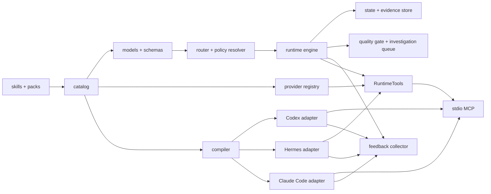

# engineering-assistant 当前架构

## 架构边界

系统由作者源、运行内核和平台输出三部分组成：

- `catalog/` 是 skill、flow、policy、pack、capability、provider、开源来源决策和 profile 的唯一机器事实源；`catalog/sources/` 把每个评估来源固定到 revision、许可证证据、采用方式和当前资产落点。
- `skills/` 和 `packs/` 是面向 agent 的指令与专业知识源。
- `schemas/` 和 `model.py` 定义平台无关协议。
- `router.py` 只消费结构化 `RouteIntent`。
- `engine.py` 执行 flow DAG、门禁和状态转换。
- `artifact_io.py`、`state_store.py` 与 `evidence.py` 提供安全路径、不可变原子创建、revision CAS 和本地 provenance 证据索引。
- `mcp_server.py` 提供小型 `RuntimeTools` 接口和 MCP stdio 协议边界。
- `feedback.py` 提供跨平台的脱敏、信号分类、精确去重和反馈持久化。
- `governance.py` 提供证据绑定的六维质量门禁和带人工选择审计的调研队列。
- `provider_runtime.py` 把固定第三方 bundle 复制为拒绝 pyc、symlink 和特殊文件的私有快照，对快照验摘要后在最小权限沙箱执行 UI/UX 建议；输出只作为不可信建议，任何失败都返回明确的原生 Provider 执行指令。
- `compiler.py` 从同一作者源构建 Codex/Hermes/Claude Code 包。
- `local_publish.py` 负责本机预发布、回滚和平台注册。

## 依赖方向

允许的依赖方向为：catalog/schema → model → router/policy/engine → RuntimeTools/CLI/compiler → adapter。

禁止：

- Model 依赖 CLI、adapter 或本机文件布局。
- Policy 包含平台专用命令。
- Skill 复制全局 policy 文本。
- Adapter 改写核心协议语义。
- 仓库保存编译后的平台包。

## 运行状态

任务运行状态存放于目标项目 `.run-artifacts/engineering-assistant/`。每个 run 包含不可变 manifest、CAS 更新的 `RunState` v2、不可变 steps/evidence/approval 记录，以及按需创建的 quality、investigation 和 provider artifact。步骤记录包含推进后的完整状态并先于状态 CAS 写入；进程若在两次写入之间中断，读取 run 时会完成恢复。`revision` 阻止并发旧写入；完成条件必须引用 Runtime 登记的本地 provenance 证据并满足节点 policy 的证据种类。

状态覆盖：运行、等待输入、等待审批、重试、阻断、取消、完成和恢复。

## 平台输出

Codex 包包含 `.codex-plugin/plugin.json`、`.mcp.json`、`hooks/hooks.json`、skills 和 `engineering-assistant/` 运行目录，`.mcp.json` 启动包内 `ea mcp-serve`；Hook manifest 注册 `UserPromptSubmit`、本插件 MCP 的 `PreToolUse`/`PostToolUse` 和 `Stop`。轻量 gate 仅在明确插件请求或活动 run 时加载 Runtime，失败始终 fail-open。Hermes 包通过 `post_llm_call` 和插件工具包装复用同一反馈采集语义，并明确平台覆盖差异。

各平台包的核心文件来自同一构建，差异只能存在于 adapter 生成的平台注册文件。

Claude Code 包由独立 adapter 生成 plugin manifest、MCP 与 hook 配置，核心语义复用同一 Runtime。Hermes 按安装根目录隔离 Python 模块，个人工具名保持 engineering_assistant_*。

模型工具暴露路由、运行发现/恢复、证据登记、审批记录、节点完成、质量快照与调研生命周期。`start` 服务端重新路由并直接返回首节点与 guidance；`complete` 保存不可变节点结果后返回下一节点；`next` 只用于恢复。项目内文件证据限制在 `project_root` 并由 Runtime 计算摘要，外部 URI 固定为 `agent_reported`。审批和调研决定是本地对话记录，不进行身份验签。Canary 只输出 `assurance=local_unattested`；真实收益晋级要求人工 reviewer record。

四种调研模式由 profile 或本地用户决定：禁用直接拒绝，只读自动模式受资料范围和成本上限约束，建议后执行使用一次明确选择，引导模式每次只允许一个资料范围并累积 contract refs。真实资料或运行环境不可用时，可以用绑定当前调研与已批准范围的本地证据结束为 `blocked`，不虚报成功条件。

反馈 Hook 是非阻断观察器：不返回 `decision:block`，不读取 transcript，不自动演进正式资产，也不允许将参考阈值升级为预算门禁。capture 和运行 ledger 使用由 session/turn 单向哈希得到的可关联伪名引用与时间戳；Codex 的插件工具 PostToolUse 会先等待全部已跟踪调用完成，成功产生效率信号候选且文本反馈完成后按已汇总 revision 条件清理 ledger；汇总期间若有并发新调用，则把快照之后的增量原子换入新的 observation，无信号时保留有界散列签名供同轮后续插件调用比较。真正缺失的 PostToolUse 只在可靠轮次结束边界汇总。Hermes ledger 在插件轮次汇总成功后删除。失败时保留重试，新插件调用机会式清理超过 24 小时的孤儿 ledger。事件、不可变处置与匿名效率候选留给目标项目的合规归档策略；处置原文元数据由人工或 CI 负责不含敏感信息。反馈汇总以每事件的轻量处置状态、最多 256 个复发键和固定大小最近项堆实现有界内存输出，不回显处置原因。Runtime 存储通过固定根目录描述符完成读、不可变写、CAS 和删除，拒绝上级目录换根或符号链接把 artifact 转移到作者源或安装目录。Codex 的非托管插件 Hook 必须由用户按当前定义哈希审查并信任后才运行。

## 安全模型

不可豁免安全规则优先级最高。外部动作、生产操作、降低安全级别和稳定版发布必须显式授权。Simulation 只用于测试报告器，不能作为产品效果证据。
