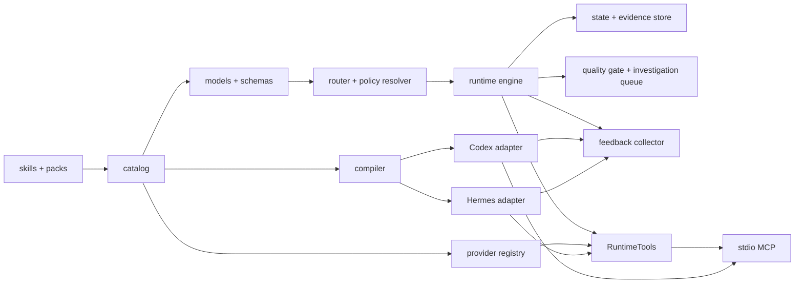

# engineering-assistant 当前架构

## 架构边界

系统由作者源、运行内核和平台输出三部分组成：

- `catalog/` 是 skill、flow、policy、pack、capability、provider 和 profile 的唯一机器事实源。
- `skills/` 和 `packs/` 是面向 agent 的指令与专业知识源。
- `schemas/` 和 `model.py` 定义平台无关协议。
- `router.py` 只消费结构化 `RouteIntent`。
- `engine.py` 执行 flow DAG、门禁和状态转换。
- `artifact_io.py`、`state_store.py` 与 `evidence.py` 提供安全路径、不可变原子创建、revision CAS 和宿主签发证据索引。
- `mcp_server.py` 提供小型 `RuntimeTools` 接口和 MCP stdio 协议边界。
- `feedback.py` 提供跨平台的脱敏、信号分类、精确去重和反馈持久化。
- `governance.py` 提供证据绑定的六维质量门禁和带人工选择审计的调研队列。
- `provider_runtime.py` 把固定第三方 bundle 复制为拒绝 pyc、symlink 和特殊文件的私有快照，对快照验摘要后在最小权限沙箱执行 UI/UX 建议；输出只作为不可信建议，任何失败都返回明确的原生 Provider 执行指令。
- `compiler.py` 从同一作者源构建 Codex/Hermes 包。
- `local_publish.py` 负责本机预发布、回滚和平台注册。

## 依赖方向

允许的依赖方向为：catalog/schema → model → router/policy/engine → RuntimeTools/CLI/compiler → adapter。

禁止：

- Model 依赖 CLI、adapter 或本机文件布局。
- Policy 包含平台专用命令。
- Skill 复制全局 policy 文本。
- Adapter 改写核心协议语义。
- 仓库保存编译后的平台包。

## 运行状态

任务运行状态存放于目标项目 `.run-artifacts/engineering-assistant/`。`RunState` 固定创建时的 profile，`revision` 用于阻止并发旧写入；审批具有有效期；完成条件必须引用当前可复核的 observed/verified 证据并满足节点 policy 的证据种类。生命周期 Hook 的 capture 和候选事件分别存放于 `feedback/captures/` 和 `feedback/events/`；质量快照和主动调研记录分别存放于每个 run 的 `quality/` 与 `investigations/`。

状态覆盖：运行、等待输入、等待审批、重试、阻断、取消、完成和恢复。

## 平台输出

Codex 包包含 `.codex-plugin/plugin.json`、`.mcp.json`、`hooks/hooks.json`、skills 和 `engineering-assistant/` 运行目录，`.mcp.json` 启动包内 `ea mcp-serve`，默认 Hook 采集每轮完成状态和下一轮人工修正。Hermes 包包含 `plugin.yaml`、`__init__.py`、skills 和相同运行目录，`__init__.py` 将同一 `RuntimeTools` 注册为 Hermes 工具，并在 `post_llm_call` 调用同一反馈采集器。

两个平台包的核心文件来自同一构建，差异只能存在于 adapter 生成的平台注册文件。

模型工具暴露路由、运行推进、质量快照，以及调研提议/查看/启动/结束能力。`start` 只接收 intent 并由内核重新路由，不能消费调用方构造的 decision。模型只能提交 `claimed` evidence；`observed`/`verified` evidence receipt、通用运行审批和调研模式 grant 必须由 RunState profile 固定的 HTTPS introspection endpoint 验证。发布包不包含签发器或私钥，自由文本 `approve`/`investigation-decide` CLI 不存在。`quality` 节点只约束 implement flow，并要求六维全部通过、证据种类兼容、所有质量证据绑定同一候选摘要且 run revision 仍匹配；设计评审不会被错误要求提交代码质量快照。

四种调研模式由 profile 或 broker 决定：禁用直接拒绝，只读自动模式受资料范围和成本上限约束，建议后执行使用一次签名选择，引导模式每次只允许一个资料范围。broker 未配置、签名无效、过期、范围或 revision 不匹配时保持等待。

反馈 Hook 是非阻断观察器：不返回 `decision:block`，不读取 transcript，不自动演进正式资产。`Stop.stop_hook_active` 为真时只记录跳过，不再生成候选，防止与其他继续型 Hook 形成循环。Codex 的非托管插件 Hook 必须由用户按当前定义哈希审查并信任后才运行。

## 安全模型

不可豁免安全规则优先级最高。外部动作、生产操作、降低安全级别和稳定版发布必须显式授权。Simulation 只用于测试报告器，不能作为产品效果证据。
