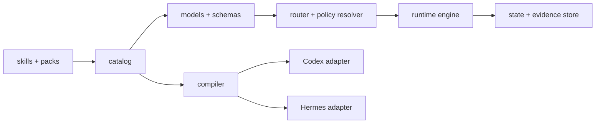

# engineering-assistant 当前架构

## 架构边界

系统由作者源、运行内核和平台输出三部分组成：

- `catalog/` 是 skill、flow、policy、pack、capability 和 profile 的唯一机器事实源。
- `skills/` 和 `packs/` 是面向 agent 的指令与专业知识源。
- `schemas/` 和 `model.py` 定义平台无关协议。
- `router.py` 只消费结构化 `RouteIntent`。
- `engine.py` 执行 flow DAG、门禁和状态转换。
- `state_store.py` 与 `evidence.py` 提供 revision-safe 持久化和证据索引。
- `compiler.py` 从同一作者源构建 Codex/Hermes 包。
- `local_publish.py` 负责本机预发布、回滚和平台注册。

## 依赖方向

允许的依赖方向为：catalog/schema → model → router/policy/engine → CLI/compiler → adapter。

禁止：

- Model 依赖 CLI、adapter 或本机文件布局。
- Policy 包含平台专用命令。
- Skill 复制全局 policy 文本。
- Adapter 改写核心协议语义。
- 仓库保存编译后的平台包。

## 运行状态

任务运行状态存放于目标项目 `.run-artifacts/engineering-assistant/`。`RunState.revision` 用于阻止并发旧写入；审批具有有效期；完成条件必须引用当前可用证据。

状态覆盖：运行、等待输入、等待审批、重试、阻断、取消、完成和恢复。

## 平台输出

Codex 包包含 `.codex-plugin/plugin.json`、skills 和 `engineering-assistant/` 运行目录；Hermes 包包含 `plugin.yaml`、`__init__.py`、skills 和相同运行目录。

两个平台包的核心文件来自同一构建，差异只能存在于 adapter 生成的平台注册文件。

## 安全模型

不可豁免安全规则优先级最高。外部动作、生产操作、降低安全级别和稳定版发布必须显式授权。Simulation 只用于测试报告器，不能作为产品效果证据。
