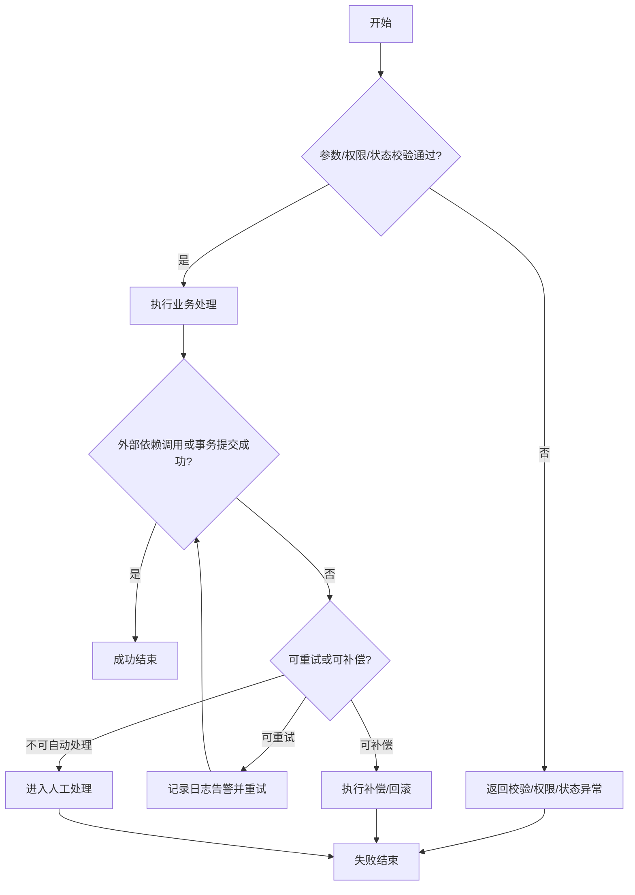
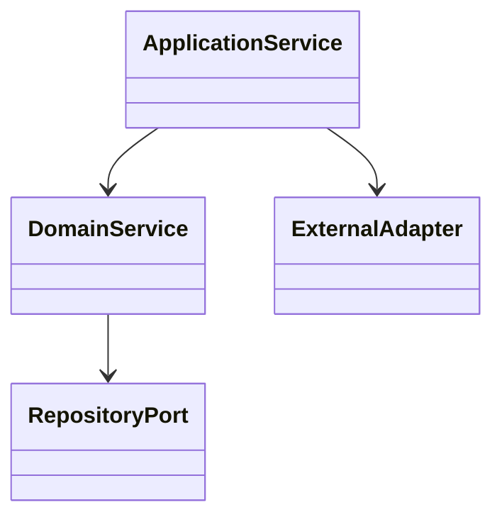

# [项目/模块名称] 详细设计说明书

## 1. 修订历史

| 版本号 | 修订日期 | 修订人 | 修订描述 |
| --- | --- | --- | --- |
| V1.0 | YYYY-MM-DD |  | 初稿创建 |

## 2. 设计背景与目标摘要

- 关联概要设计：`high-level-design.md`
- 核心目标摘要：

### 2.1 原始需求与原型引用矩阵

| source_id | source_type | source_path_or_url | prototype_page_or_section | requirement_item | design_section | consistency_status |
| --- | --- | --- | --- | --- | --- | --- |
|  | requirement_spec / prototype |  |  |  |  | matched / pending_confirmation / conflict |

## 3. 模块/功能详细设计

### 3.1. 业务流程图

流程设计说明：

- 业务规则：说明本流程的核心业务判断、状态流转和不变式。
- 校验规则：说明参数校验、权限校验、状态校验失败时的返回和终态。
- 事务边界：说明本地事务、跨资源一致性、提交失败和回滚动作。
- 幂等与一致性：说明幂等键、重复请求处理、最终一致性和乱序处理。
- 异常场景：见下表，必须覆盖校验失败、外部依赖失败、事务/一致性失败和不可自动恢复场景。
- 日志要求：说明 traceId、业务主键、异常编码、告警维度和敏感信息脱敏。
- 取消、重试、补偿、文件清理：说明可重试条件、补偿/回滚动作、人工处理入口和失败终态。

| 场景 | 触发条件 | 异常编码 | 异常信息 | 系统处理动作 | 数据状态 | 日志/告警 | 补偿/重试/人工处理 |
| --- | --- | --- | --- | --- | --- | --- | --- |
| 参数/权限/状态校验失败 | 入参缺失、无权限或当前状态不允许继续 |  |  | 拒绝处理并返回失败 | 不落库或保持原状态 | 记录 traceId、用户、业务主键 | 无需补偿，必要时提示人工确认输入 |
| 外部依赖失败 | 服务调用超时、返回失败或熔断 |  |  | 记录失败原因并按策略重试或降级 | 本地状态保持处理中/失败待补偿 | 告警依赖名称、耗时、错误码 | 可重试则重试；不可重试进入人工处理 |
| 事务/一致性失败 | 本地事务提交失败、消息发送失败或状态不一致 |  |  | 回滚事务或写入补偿任务 | 回滚到提交前状态或标记待补偿 | 告警事务边界、补偿任务 ID | 执行补偿/回滚，失败后人工处理 |

### 3.2. UML类图

类图说明：

## 4. 数据库设计

| 设计项 | 关联文档 | 说明 |
| --- | --- | --- |
| 数据库专项设计 | `database-design.md` | 关联关系型 OLTP/OLAP 数据库模板，不在主详细设计展开字段和索引 |

## 5. 接口定义

### 5.1. API接口列表

| 接口名称 | YApi链接 | 接口路径 | 说明 |
| --- | --- | --- | --- |
|  |  |  |  |

### 5.2. 中间件设计

| 中间件 | 是否涉及 | 关联文档 | 评审要求 |
| --- | --- | --- | --- |
| MQ | 是/否 | `mq-design.md` | 遵循 MQ 设计模板并完成对应评审 |
| Redis | 是/否 | `redis-design.md` | 遵循 Redis 设计模板并完成对应评审 |

## 6. 单元测试

| 测试对象 | 正常流程 | 分支流程 | 异常流程 | 断言 |
| --- | --- | --- | --- | --- |
|  |  |  |  |  |

## 7. 性能与扩展性设计

## 8. 人工评审项
