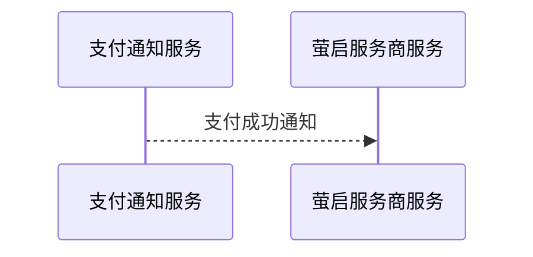

# DFZ-001 设计产物失败复盘：插件门禁回归样例

## 背景

用户要求基于 PRD 使用 `teamwork-engineering-assistant` 生成设计产物。生成后用户指出三个问题：

1. 概要设计时序图中出现“支付通知服务”“权限组织服务”，但这些服务没有当前项目代码证据。
2. 数据库设计没有完整使用 OLTP 数据库设计模板，而是裁剪成摘要式文档。
3. 正确目标应先排查根因，而不是直接修改设计文档。

## 失败模式

### 1. 无证据服务进入概要设计时序图

错误示例：

问题：`PaymentNotifyService` 是抽象能力名，不是从 repo_context 证实的服务。

应要求：

- participant 必须能追溯到代码路径、配置路径、已有文档或用户明确补充。
- proposed/unknown 参与方不能进入正式时序图。
- 找不到证据时进入 `waiting_for_input` 或 `waiting_for_human_review`。

真实证据示例：

- `operation/si-rrq-franchisemanagement-service/src/main/java/com/snbc/vems/managemnet/mqlistener/FranchiseeListener.java`
- `@RabbitListener(queues = "${sh.franchisee.common.queue}")`
- `strategyFactory.dispatch(message)`

### 2. 数据库模板裁剪

错误模式：只生成 100 行左右的摘要式 `database-design.md`，缺失 OLTP 模板中的固定章节。

必须保留：

- `1.1 变更记录`
- `1.2 术语定义`
- `1.3 参考文档`
- `2. 文档定位`
- `3.2 核心业务场景`
- `5. 数据量与性能设计`
- `6. CRUD 契约设计（OLTP 核心）`
- `7. 事务、一致性与并发控制`
- `8. 分区、分片与归档设计`
- `9. 安全与审计设计`
- `10. 测试与验收`
- `11. 附录`

正确做法：从 `assets/database-oltp-template.md` 复制完整骨架，逐节填充。缺少事实时保留章节并写“不适用原因”，或进入 `waiting_for_input`。

### 3. 专项 validator 失败未冒泡

错误模式：主 workflow 校验通过，但 database-design validator 失败后仍汇报完成。

正确门禁：任一正式专项产物 validator 失败，总 workflow 必须 `blocked`。

### 4. 用户指出质量问题后的处理顺序

错误模式：马上重写文档。

正确模式：先进入 defect-analysis，输出：

- symptom
- evidence
- violated_rule
- root_cause
- required_plugin_control
- whether_artifact_should_be_invalidated

根因明确后，才能创建新 run 目录进入 repair_generation。

## 建议回归检查

1. high-level-design validator 解析 Mermaid `sequenceDiagram` participant。
2. 检查每个 participant 是否存在 `repo-context/participant-evidence-map.json` 记录。
3. database-design validator 失败时 workflow-orchestrator 必须 blocked。
4. 用户输入包含“脱离实际”“模板裁剪”“先排查根因”等信号时，workflow 进入 defect-analysis 模式。
